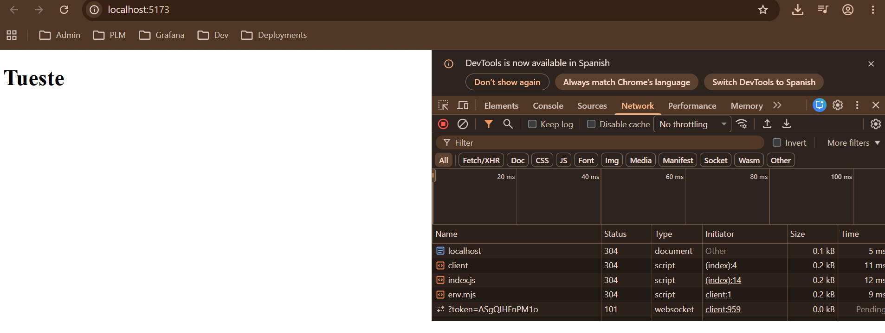

# Lab 03 · Bundling con Vite

La tienda de _Tueste_ montada con Vite **a mano**, desde un `package.json`
vacío (sin `npm create vite`): Sass, imágenes, TypeScript con comprobación de
tipos, React y variables de entorno.

<!-- TODO (obligatorio 7): este README se completa al final con las
     respuestas, capturas, la salida de npm run build, el checklist y la
     bitácora de IA. -->

## Cómo arrancarlo

### Con DevContainer (recomendado)
1. Abre la raíz del repo en VS Code → *Dev Containers: Reopen in Container*.
2. La primera vez, el contenedor (Node 24) clona el repo en el volumen de
   Docker `lemoncode-fe-luckia` e instala las dependencias de todos los
   laboratorios (`postCreateCommand`).
   Si el contenedor ya existía de antes del lab 3, haz *Dev Containers:
   Rebuild Container* (para pasar a Node 24 y reenviar el puerto 4173) o, como
   mínimo, instala a mano:
   ```bash
   cd 03-Bundling/lab-bundling
   npm install
   ```
3. En la terminal del contenedor:
   ```bash
   cd 03-Bundling/lab-bundling
   npm start
   ```
4. Abre http://localhost:5173. VS Code reenvía los puertos 5173 (desarrollo)
   y 4173 (preview) del contenedor a tu máquina.

### En local (Node 20.19+; recomendado 24)
```bash
cd 03-Bundling/lab-bundling
npm install
npm start
```

### Scripts

| Comando | Qué hace |
|---|---|
| `npm start` | Servidor de desarrollo de Vite en http://localhost:5173: sirve los ficheros sin empaquetar, transformados al vuelo, con HMR |
| `npm run build` | Genera la versión de producción en `dist/`: empaquetada, minificada y con hash en los nombres |
| `npm run preview` | Sirve la carpeta `dist/` ya construida en http://localhost:4173, para comprobar la versión de producción |

`start` y `preview` llevan `--host`: sin él, Vite sólo escucha en `localhost`,
que con Node 17+ se resuelve a la dirección IPv6 `::1`. El reenvío de puertos
de VS Code entra en el contenedor por `127.0.0.1` (IPv4), así que la página no
cargaba desde el navegador de la máquina anfitriona aunque Vite arrancara sin
errores. Con `--host`, Vite escucha en todas las interfaces del contenedor
(`0.0.0.0`).

## Checklist

### Obligatorios
- [x] 1 - Proyecto desde cero
- [x] 2 - Estilos con Sass
- [x] 3 - Imágenes
- [ ] 4 - TypeScript con comprobación de tipos
- [ ] 5 - React
- [ ] 6 - Variables de entorno
- [ ] 7 - README + bitácora de IA

### Opcionales
- [ ] 1 - Tailwind
- [ ] 2 - Code splitting y análisis del bundle

## 1 - Proyecto desde cero

`package.json` creado con `npm init -y` y limpiado: `"private": true` (npm
no deja publicarlo), `"type": "module"` (Node trata los `.js` como ES
modules), Vite 8.3.5 en `devDependencies` y los tres scripts. Se han quitado
`main`, `description`, `keywords`, `author`, `license` y el script `test`:
sirven para publicar un paquete en npm, y este proyecto es una web privada
cuyo punto de entrada es `index.html`, no un `main`.

### Salida de `npm run build`

```
vite v8.3.5 building client environment for production...
transforming...
✓ 4 modules transformed.
rendering chunks...
computing gzip size...
dist/index.html                0.38 kB │ gzip: 0.26 kB
dist/assets/index-Cbd1MwUr.js  0.70 kB │ gzip: 0.42 kB

✓ built in 43ms
```

`dist/index.html` ya no apunta a `/src/index.js`, sino al fichero con hash:

```html
<script type="module" crossorigin src="/assets/index-Cbd1MwUr.js"></script>
```

### Captura: `index.js` responde 304 al recargar con F5



_Network con `npm start`: al recargar con F5, `index.js` responde 304 Not
Modified porque el navegador manda su ETag y el fichero no ha cambiado._

### Preguntas

**¿Para qué sirve el hash del nombre del fichero en producción? ¿Qué pasaría
sin él cuando subís una versión nueva?**

El hash se calcula a partir del contenido del fichero: si el código cambia,
cambia el nombre (`index-Cbd1MwUr.js` pasa a ser otro). Así el servidor puede
decirle al navegador que guarde esos ficheros en caché para siempre, y cuando
sale una versión nueva el `index.html` apunta a un nombre distinto que el
navegador todavía no tiene y descarga. Sin hash, el fichero se seguiría
llamando `index.js`: los usuarios que lo tuvieran en caché seguirían usando la
versión antigua hasta que caducara la caché o forzaran la recarga.

**¿Qué diferencia hay entre `npm start` y `npm run preview`? ¿Cuál usaríais
para comprobar que la versión de producción funciona?**

`npm start` arranca el servidor de desarrollo: no empaqueta, transforma cada
fichero cuando el navegador lo pide.
`npm run preview` no transforma nada: sirve tal cual la carpeta `dist` que ha
generado `npm run build`, empaquetada y minificada.

## 2 - Estilos con Sass

Se ha instalado sólo `sass-embedded` como `devDependency`
(`npm install -D sass-embedded`), que es justo lo que pedía el error de Vite
al importar `main.scss` sin compilador: `Preprocessor dependency
"sass-embedded" not found. Did you install it? Try npm install -D
sass-embedded`. Vite ya trae el soporte de `.scss` y sólo necesita el
compilador; `sass-embedded` es el compilador oficial de Dart Sass y es el que
Vite prefiere, así que ni `sass`, ni `node-sass` (obsoleto) ni loaders.

Las variables viven en `src/styles/_variables.scss` y `main.scss` las carga
con `@use "variables" as *;` (`@import` está obsoleto en Sass).

### Salida de `npm run build`

```
vite v8.3.5 building client environment for production...
transforming...
✓ 5 modules transformed.
rendering chunks...
computing gzip size...
dist/index.html                 0.57 kB │ gzip: 0.35 kB
dist/assets/index-B-6UkqOc.css  0.30 kB │ gzip: 0.20 kB
dist/assets/index-DKo7hhUa.js   0.70 kB │ gzip: 0.42 kB

✓ built in 207ms
```

`dist/index.html` enlaza el CSS generado, ya sin variables de Sass
(`$tueste-900` es ahora `#2e1a10`):

```html
<link rel="stylesheet" crossorigin href="/assets/index-B-6UkqOc.css">
```

### Pregunta

**¿Por qué en desarrollo el CSS llega como un módulo de JavaScript y en
producción como un fichero `.css`?**

En desarrollo, Vite compila el `.scss` y lo devuelve envuelto en un módulo JS
que llama a `updateStyle()` para meter el CSS en un `<style>` del `<head>` y
acepta su propio HMR (`import.meta.hot.accept()`): al guardar, sólo se vuelve
a pedir ese módulo y se sustituye el `<style>`, sin recargar la página ni
volver a ejecutar `index.js`. <!-- REVISAR: el navegador no puede hacer
`import` de un .css, por eso hace falta envolverlo en JS --> En producción no
hay HMR que mantener, así que Vite extrae el CSS a un fichero `.css` con hash
y lo enlaza con un `<link>` en el `index.html`: el navegador lo descarga en
paralelo con el JS, lo puede cachear por separado y la página no espera a que
se ejecute ningún script para tener estilos. <!-- REVISAR: lo del parpadeo
sin estilos (FOUC) si el CSS dependiera del JS -->

## 3 - Imágenes

Dos imágenes en `src/assets/`, sin instalar nada ni tocar la configuración:
Vite ya sabe tratar imágenes.

- `logo.svg` (629 B): el icono `coffee` de [Lucide](https://lucide.dev)
  (licencia ISC, indicada en un comentario del propio SVG), con el trazo en
  `#9a5b33` (`$tueste-500`) en vez de `currentColor`: un SVG cargado con
  `` es un documento aparte y no hereda el `color` del CSS de la página.
  Va en la cabecera del `index.html` con
  ``.
- `coffee.jpg` (5,4 MB): se importa desde `src/index.js`. El `import`
  devuelve un texto, la URL de la imagen, y con él se crea el ``:

```js
import coffeePhoto from "./assets/coffee.jpg";

console.log(coffeePhoto);
// en desarrollo → "/src/assets/coffee.jpg"
// en producción → "/assets/coffee-VeBrprW9.jpg"
```

### Salida de `npm run build`

```
vite v8.3.5 building client environment for production...
transforming...
✓ 6 modules transformed.
rendering chunks...
computing gzip size...
dist/index.html                      1.39 kB │ gzip: 0.74 kB
dist/assets/coffee-VeBrprW9.jpg  5,489.84 kB
dist/assets/index-BeDCDn6j.css       0.21 kB │ gzip: 0.16 kB
dist/assets/index-kzBbny1D.js        0.84 kB │ gzip: 0.48 kB

✓ built in 181ms
```

La foto sale como fichero con hash; el logo no aparece en `dist/assets`. En
`dist/index.html`, el `src` del `` es ahora el propio SVG:

```html
`. Lo decide
[`build.assetsInlineLimit`](https://vite.dev/config/build-options#build-assetsinlinelimit):
los assets importados o referenciados que pesan menos de ese límite se
incrustan en el fichero que los usa en vez de salir como fichero aparte. En
Vite 8 vale `4096` (4 KiB) por defecto; el logo pesa 629 B y se incrusta, la
foto pesa 5,4 MB y sale como `coffee-<hash>.jpg`. Los SVG no se pasan a
base64 (aunque la documentación diga *base64 URLs*): Vite los mete como texto
escapando sólo algunos caracteres (`%3c`, `%20`…), que ocupa menos.

- **Ganamos**: una petición HTTP menos, y el logo llega con el HTML, sin
  esperar a otra descarga ni ver un hueco mientras carga.
- **Perdemos**: el logo no se cachea por separado y vuelve a viajar con cada
  descarga del HTML (y en cada página que lo use); cualquier cambio en el logo
  invalida el fichero que lo contiene, y el HTML es más difícil de leer. En
  base64, además, ocuparía alrededor de un 33 % más. Por eso el límite es
  pequeño: sólo compensa con ficheros diminutos.

## Bitácora de IA

Herramienta: **Claude Code** (extensión de VS Code), dentro del DevContainer,
con las reglas del lab en `CLAUDE.md`: Vite 8 (Rolldown + Oxc), nada de
`npm create vite`, `@use` en Sass, sólo `sass-embedded`, `import.meta.env.VITE_X`
y cada dependencia justificada.

La bitácora completa, con el prompt, lo que me dio y lo que corregí en cada
caso, está en [`../bitacora.md`](../bitacora.md):

- **1 · Proyecto desde cero**: me dijo que en el DevContainer no hacía falta
  `--host`. Vite escuchaba sólo en `::1` (IPv6) y el reenvío de VS Code llega
  por `127.0.0.1`, así que la página no cargaba. Lo arreglé con `--host` en
  los scripts de `start` y `preview`.
