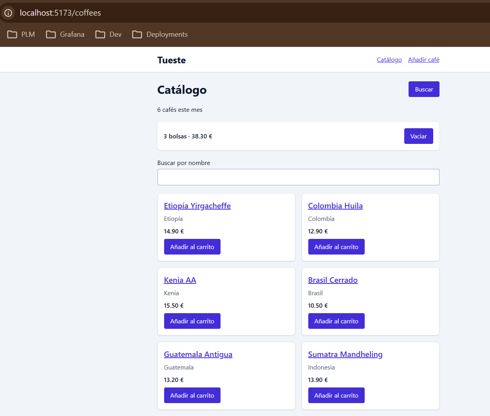
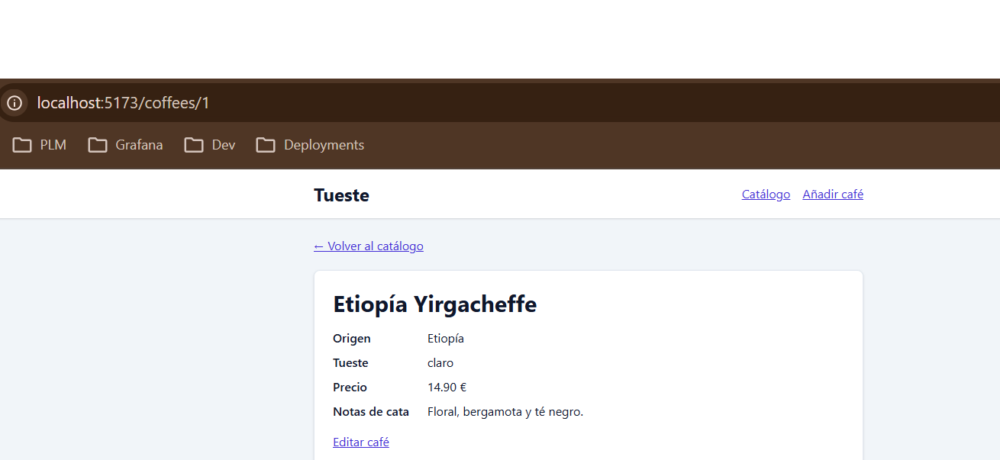
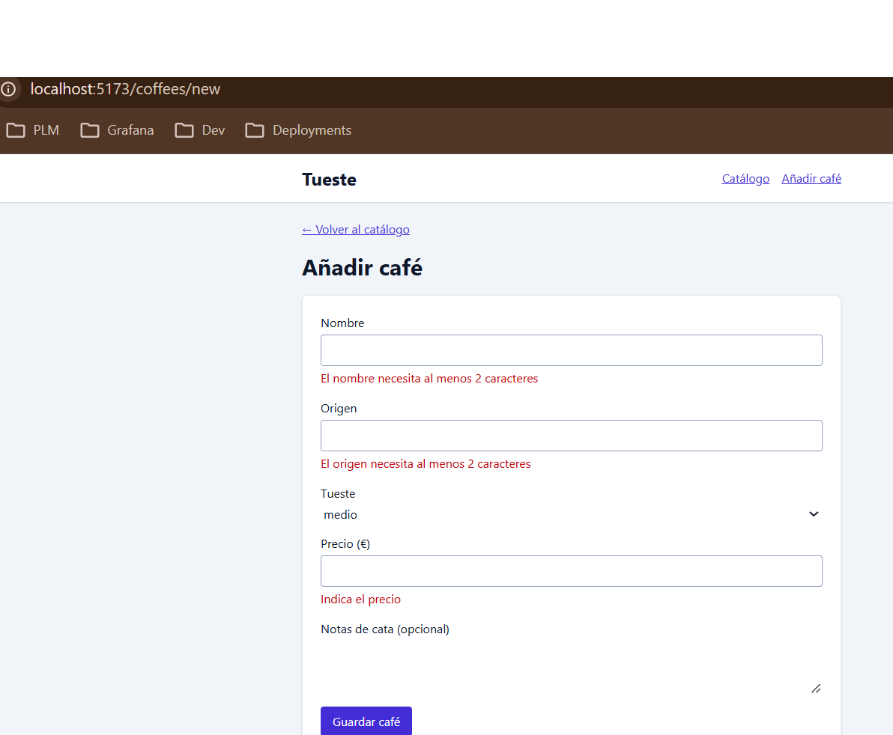
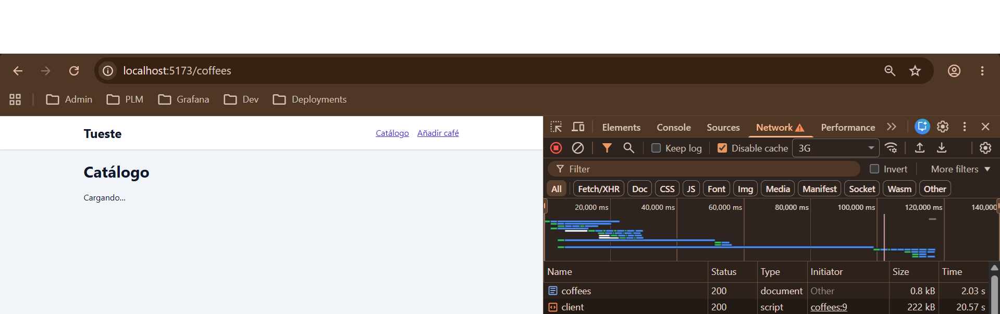
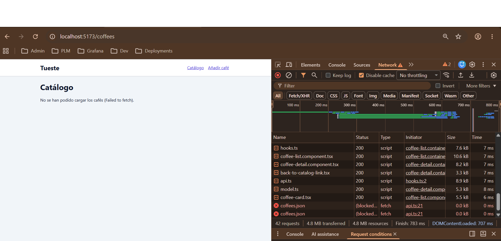

# Lab 04 · React

El catálogo de _Tueste_ con React: lista con buscador y carrito, detalle de
cada café y formularios de alta y edición. Parte de la demo
`01-de-javascript-a-react/demos/02-react` del módulo (Vite 8, TypeScript,
React 19 y Tailwind 4 ya configurados).

## Cómo arrancarlo

Necesita Node.js 22.12 o superior.

### Con DevContainer (recomendado)
1. Abre la raíz del repo en VS Code → *Dev Containers: Reopen in Container*.
2. Al crear el contenedor se instalan las dependencias de todos los
   laboratorios, este incluido (`postCreateCommand`). Si el contenedor ya
   existía de antes del lab 4, haz *Dev Containers: Rebuild Container* o
   instala a mano con `npm install` dentro de `04-Frameworks/lab-react`.
3. En la terminal del contenedor:
   ```bash
   cd 04-Frameworks/lab-react
   npm start
   ```
4. Abre http://localhost:5173 (VS Code reenvía el puerto del contenedor).

### En local
```bash
cd 04-Frameworks/lab-react
npm install
npm start
```

### Build y preview
```bash
npm run build     # vite build && tsc --noEmit
npm run preview   # sirve dist/ en http://localhost:4173
```

Para comprobar la entrega desde cero (como la clonaría otra persona):
```bash
rm -rf node_modules dist
npm ci            # instala exactamente lo de package-lock.json
npm run build
```

### Scripts
| Script | Qué hace |
| --- | --- |
| `npm start` | Servidor de desarrollo de Vite en http://localhost:5173. Con `--host` escucha en todas las interfaces (`0.0.0.0`) y no sólo en `[::1]`, para que el reenvío de puertos del DevContainer llegue (ver bitácora del lab 3, entrada 1) |
| `npm run build` | `vite build && tsc --noEmit`: primero `vite build` genera `dist/` y, de paso, el plugin de TanStack Router regenera `src/routeTree.gen.ts`; después `tsc --noEmit` comprueba los tipos, que necesitan ese fichero ya generado (desde O5; antes era `tsc --noEmit && vite build`) |
| `npm run typecheck` | Sólo la comprobación de tipos |
| `npm run preview` | Sirve `dist/` en http://localhost:4173, también con `--host` |

## Datos de partida
- `public/coffees.json`: los 6 cafés iniciales (se piden con `fetch` a partir de O3).
- `src/core/coffees/model.ts` (hasta O6, `src/model.ts`): los tipos `Roast`,
  `Coffee` y `CoffeeInput` y los nombres en español de cada tueste
  (`roastLabels`).
- Desde O6, los cafés que se dan de alta se guardan en `localStorage` con la
  clave `tueste.coffees` (la lista completa: los 6 iniciales más los nuevos).
  Desde O7 también se guardan ahí los cafés editados. Si se borra esa clave,
  al recargar vuelven los 6 cafés de `coffees.json`.

## Mapa de la aplicación
Rutas por archivos con TanStack Router: cada fichero de `src/routes` es una
ruta y el plugin de Vite genera con ellos `src/routeTree.gen.ts` (se versiona
y no se edita a mano).

Desde O7 cada ruta sólo lee sus parámetros y pinta una **escena**
(`src/scenes`). La escena compone la pantalla con los **pods**
(`src/pods/catalogo` y `src/pods/edicion`) y decide adónde se navega.

Todas las pantallas se pintan dentro del layout `src/layouts/app-layout.tsx`
(lo monta `src/routes/__root.tsx`): nombre de la tienda, navegación con
"Catálogo" y "Añadir café" y `<Outlet />`.

| Ruta | Escena (`src/scenes`) | Qué muestra |
| --- | --- | --- |
| `/` | — | Nada: `src/routes/index.tsx` redirige a `/coffees` en `beforeLoad` |
| `/coffees` | `catalog.scene.tsx` | El catálogo (`CoffeeListContainer`, pod catálogo): buscador con botón "Buscar", carrito ("N bolsas · total €" y "Vaciar") y tarjetas. El nombre de cada café enlaza a su detalle |
| `/coffees/new` | `new-coffee.scene.tsx` | El formulario vacío (`CoffeeFormContainer` sin `coffeeId`, pod edición). Al guardar se crea un café con id nuevo y se abre su detalle. Como `new` es un segmento fijo, el router lo prefiere a `$coffeeId` |
| `/coffees/$coffeeId` | `coffee-detail.scene.tsx` | El detalle de un café (`/coffees/3`, `CoffeeDetailContainer`, pod catálogo): origen, tueste, precio, notas de cata y el enlace "Editar café". "Café no encontrado" si el id no existe o no es un número (`/coffees/999`, `/coffees/abc`) |
| `/coffees/$coffeeId/edit` | `edit-coffee.scene.tsx` | El mismo formulario con los valores del café (`CoffeeFormContainer` con `coffeeId`). Al guardar se sustituye ese café, que conserva su id, y se vuelve a su detalle. "Café no encontrado" con `/coffees/999/edit` |
| cualquier otra (404) | — | "Página no encontrada" y un enlace al catálogo: el `notFoundComponent` de `src/routes/__root.tsx` (`/teteras`) |

### Estructura de `src`
```
src/
  main.tsx                 <StrictMode> + <RouterProvider>
  routeTree.gen.ts         lo genera el plugin del router (no se edita)
  routes/                  sólo navegación: leen parámetros y pintan una escena
    __root.tsx  index.tsx
    coffees/  index.tsx  new.tsx  $coffeeId/index.tsx  $coffeeId/edit.tsx
  scenes/                  componen la pantalla y deciden adónde navegar
    catalog · coffee-detail · new-coffee · edit-coffee (.scene.tsx)
  pods/
    catalogo/              lista, buscador, carrito y detalle
      index.ts             lo único que importan las escenas
      coffee-list.container.tsx · coffee-list.component.tsx
      coffee-detail.container.tsx · coffee-detail.component.tsx
      components/          coffee-card.tsx · back-to-catalog-link.tsx
    edicion/               formulario de alta y edición
      index.ts
      coffee-form.container.tsx · coffee-form.component.tsx
  core/
    router/router.ts       createRouter + declare module … Register
    coffees/               lo que comparten los dos pods
      model.ts · coffee.schema.ts · api.ts · hooks.ts
  layouts/app-layout.tsx   cabecera, navegación y <Outlet />
  common/components/       LoadingMessage · ErrorMessage · NotFoundMessage
```

Los datos viven en `src/core/coffees`, que comparten los dos pods:

- **`api.ts`**: `getCoffees` y `getCoffee` leen primero de `localStorage` y,
  si no hay nada, piden `/coffees.json`. `createCoffee` (alta) y
  `updateCoffee` (edición) guardan la lista completa.
- **`hooks.ts`**: `useCoffees` (catálogo) y `useCoffee(id)` (detalle y
  edición).
- **`coffee.schema.ts`**: el esquema de Zod. Lo usan el alta y la edición.

### Cómo se escribió `saveCoffee` (en O7, `createCoffee` y `updateCoffee`)
El enunciado de O6 dice "ampliad vuestro api.ts con el `saveCoffee` de la
demo", pero no tenía el código de esa demo. En lugar de copiarlo, lo
escribimos a partir de lo que pide el enunciado:

- **Clave propia en `localStorage`** (`tueste.coffees`) con la **lista
  completa**, no solo los cafés nuevos. Así hay una única fuente de datos
  después del primer alta.
- **`getCoffees` lee primero de `localStorage`** y solo si no hay nada (o lo
  guardado no pasa `isCoffeeList`) pide `/coffees.json`. Como `getCoffee`
  ya usaba `getCoffees`, el detalle encuentra también los cafés nuevos sin
  cambiarlo.
- **Id nuevo = máximo + 1**: `Math.max(0, ...coffees.map((coffee) => coffee.id)) + 1`
  (el `0` cubre una lista vacía).
- **Sin mutar la lista**: se guarda `[...coffees, { ...input, id }]`, nunca
  `coffees.push(...)`.
- **Retraso simulado de 600 ms** antes de guardar, para que se vea el
  botón "Guardando…" desactivado mientras `isSubmitting` es `true`.
- **`signal` opcional** en `getCoffees`: los hooks le pasan el de su
  `AbortController`, pero `saveCoffee` no tiene nada que cancelar y lo llama
  sin argumentos.
- **En O7 se separó en dos funciones**: `createCoffee(input)` calcula el id
  nuevo y añade el café al final, y `updateCoffee(id, input)` sustituye ese
  café con `coffees.map((coffee) => (coffee.id === id ? updated : coffee))`.
  Así conserva el id y el sitio en la lista, sin mutar nada. Si el id ya no
  existe, `updateCoffee` lanza un error en vez de crear un café sin avisar.
  La otra opción era un `saveCoffee(input, id?)`, pero entonces una sola
  función tendría dos comportamientos según un parámetro opcional.
- **Se guardan los datos ya transformados por el esquema**: `CoffeeForm`
  llama a `onSave(coffeeSchema.parse(value))`, porque el `value` de TanStack
  Form llega sin el `trim`.

## Checklist

### Obligatorios
- [x] O1 · El catálogo con componentes
- [x] O2 · Un carrito con estado y eventos
- [x] O3 · Cargar los cafés con useEffect
- [x] O4 · Un custom hook y una ref
- [x] O5 · Lista y detalle con TanStack Router
- [x] O6 · Alta de cafés con TanStack Form y Zod
- [x] O7 · Edición y organización en pods
- [x] O8 · README + bitácora de IA

### Opcionales
- [ ] P1 · Un carrito que no se pierde
- [ ] P2 · Y que sobreviva también a recargar
- [ ] P3 · Una cuenta atrás para la oferta
- [ ] P4 · Filtros que viven en la URL
- [ ] P5 · Memorizar… con cabeza
- [ ] P6 · CSS Modules
- [ ] P7 · Eliminar un café

### Desafíos
- [ ] D1 · Una búsqueda con debounce
- [ ] D2 · React Compiler
- [ ] D3 · Un contrato de API distinto
- [ ] D4 · Tests de componentes
- [ ] D5 · Hacia TanStack Start

## Respuestas

Las respuestas se escribieron al terminar cada obligatorio y se han revisado
con el código final: las rutas de fichero son las de después de O7 (pods). Si
en ese obligatorio el código vivía en otro sitio, se indica entre paréntesis.

### O1

**¿Qué aviso da React sin key y para qué la necesita? ¿Por qué usáis coffee.id y no el índice del map?**

Sin `key`, React escribe en la consola ``Each child in a list should have a unique "key" prop. Check the render method of `App`. See https://react.dev/link/warning-keys for more information.`` (en O1 la lista se pintaba en `App`; hoy el aviso nombraría a `CoffeeList`): necesita la `key` para saber qué elemento de la lista es cuál entre un render y el siguiente, y así reutilizar, mover o quitar sólo el `<li>` que ha cambiado en lugar de rehacerlos todos. En `src/pods/catalogo/coffee-list.component.tsx` (en O1, `src/app.tsx`) usamos `key={coffee.id}` porque el `id` va con el café y no cambia nunca, mientras que el índice depende de la posición: en cuanto el buscador filtra la lista o se añade un café, el índice 0 pasa a ser otro café y React reutilizaría el elemento (y su estado) equivocado.

### O2

**¿Por qué escribís onAdd={addToCart} y no onAdd={addToCart()}?**

Con `onAdd={addToCart}` le pasamos la función misma (en `src/pods/catalogo/coffee-list.container.tsx`, que se la da a `CoffeeList` y ésta a cada `CoffeeCard`), para que sea la tarjeta quien la llame cuando se pulse su botón (`onClick={() => onAdd(coffee)}` en `src/pods/catalogo/components/coffee-card.tsx`). Con `onAdd={addToCart()}` la estaríamos ejecutando durante el render y pasando su resultado (`void`, en ejecución `undefined`), así que TypeScript ya protesta (falta el argumento `coffee` y `void` no es asignable a `(coffee: Coffee) => void`); y si compilara, cada render llamaría a `setCart`, que provoca otro render, en bucle infinito ("Too many re-renders").

**¿Por qué el total del carrito no necesita su propio useState? ¿Qué problema podríais tener si lo fuera?**

Porque se deduce entero de `cart`: en `CoffeeListContainer` se calcula en cada render con `cart.reduce((sum, coffee) => sum + coffee.price, 0)`, y como cada `setCart` provoca un render, el total siempre corresponde al carrito que se está pintando. Si fuera un estado aparte habría dos fuentes de verdad que mantener sincronizadas a mano: por ejemplo, con `const [total, setTotal] = useState(0)` y un `useEffect(() => setTotal(...), [cart])`, al añadir el Kenia AA el primer render pinta "1 bolsa · 0.00 €" (cart ya cambió, total todavía no) y sólo después el efecto fuerza un segundo render con "15.50 €"; y si en `emptyCart` alguien hace `setCart([])` pero olvida `setTotal(0)`, se queda "0 bolsas · 15.50 €".

### O3

**¿Por qué la petición va dentro de un useEffect y no directamente en el cuerpo del componente? ¿Qué significa el [] del final?**

El cuerpo de un componente se ejecuta en cada render y tiene que ser puro: un `fetch` ahí lanzaría una petición nueva en cada render, y como al llegar la respuesta llamamos a `setCoffees`, que provoca otro render, pediríamos `/coffees.json` en bucle sin fin; `useEffect` saca la petición del render y la ejecuta después de que React pinte. El `[]` es la lista de dependencias vacía: el efecto no depende de ningún valor del componente, así que sólo se ejecuta al montarlo (y su limpieza, `controller.abort()`, al desmontarlo), no cuando cambian `cart` o `query`. Hoy ese efecto está en `useCoffees` (`src/core/coffees/hooks.ts`) y se monta con `CoffeeListContainer`; en O3 estaba en `App`. Con `<StrictMode>`, en desarrollo React monta, desmonta y vuelve a montar el componente: la limpieza aborta la primera petición (en Network sale cancelada y en el `catch` la ignoramos porque `controller.signal.aborted` es `true`) y sólo la segunda llega a cambiar el estado.

### O4

**Si dos componentes distintos llaman a useCoffees(), ¿comparten los mismos datos o cada uno tiene los suyos? ¿Cuántas peticiones se hacen?**

Cada uno tiene los suyos: un custom hook (`src/core/coffees/hooks.ts`; en O4, `src/use-coffees.ts`) sólo reutiliza la lógica, y cada llamada crea sus propios `useState` y su propio `useEffect` dentro del componente que lo llama, igual que si hubiéramos copiado el código en los dos. Por eso en Network se ven dos peticiones a `/coffees.json` (una por componente) en el build de producción. En desarrollo se ven cuatro: `<StrictMode>` monta, desmonta y vuelve a montar cada componente, así que cada uno lanza una petición que su limpieza (`controller.abort()`) cancela y otra que sí termina. (Desde O6, si ya hay cafés guardados en `localStorage`, `getCoffees` los lee de ahí y no se ve ninguna petición: para repetir la prueba hay que borrar la clave `tueste.coffees`.)

**¿Por qué el foco se hace con una ref y no con un estado?**

Porque poner el foco no es algo que se pinte: es una orden imperativa al nodo del DOM (`searchRef.current?.focus()` en `src/pods/catalogo/coffee-list.component.tsx`), y `useRef` nos da acceso a ese `<input>` sin provocar ningún render. Con un estado (`const [focused, setFocused] = useState(false)`) tendríamos que forzar un render que no cambia nada en pantalla y luego un `useEffect` que, al final, necesitaría igualmente el nodo para llamar a `.focus()`; además, el estado se quedaría a `true` cuando el usuario saliera del campo y un segundo clic en "Buscar" ya no haría nada.

### O5

**¿Qué ganamos con una URL por pantalla frente a mostrar el detalle con un booleano en el estado?**

Con una URL por pantalla, la pantalla que se ve es parte de la dirección y no de un estado que se pierde: `/coffees/4` se puede guardar en marcadores, compartir o recargar y se vuelve a abrir ese mismo café, y los botones Atrás y Adelante del navegador funcionan porque cada navegación es una entrada del historial. Con un booleano (`const [showDetail, setShowDetail] = useState(false)`) la URL sería siempre la misma, al recargar se volvería al catálogo y Atrás sacaría al usuario de la aplicación. Además, con TanStack Router el `Link` está tipado: TypeScript comprueba que `/coffees/$coffeeId` existe y que le pasamos su parámetro; si en `coffee-card.tsx` escribimos `params={{ coffeeID: ... }}` da `error TS2353: Object literal may only specify known properties, and 'coffeeID' does not exist in type 'ParamsReducerFn<...> | { ...; }'.`

**Según la comprobación 5: ¿por qué se ha vaciado el carrito? ¿Dónde tendría que vivir ese estado para no perderse?**

El estado `cart` es un `useState` de `CoffeeListContainer` (en O5 estaba en `CoffeesPage`, el componente de `src/routes/coffees/index.tsx`), que sólo se pinta en `/coffees`. Al navegar a `/coffees/3` el router deja de pintar esa ruta en el `<Outlet />` y pinta la del detalle (`src/routes/coffees/$coffeeId/index.tsx`; en O5, `$coffeeId.tsx`): `CoffeeListContainer` se desmonta y React tira su estado. Al volver a `/coffees` se monta uno nuevo, que arranca con `useState<Coffee[]>([])` (y vuelve a pedir los cafés). Para que no se pierda, el carrito tendría que vivir en un componente que no se desmonte al navegar, el layout (`src/layouts/app-layout.tsx`), y llegar a las pantallas que lo necesiten con Context (`createContext` + un hook `useCart()`), que es el opcional P1.

### O6

**Ya teníais la interfaz Coffee en TypeScript. ¿Para qué hace falta además un esquema de Zod?**

La interfaz `Coffee` sólo existe en compilación: `tsc` la comprueba sobre el código que escribimos y desaparece del JavaScript que llega al navegador, así que no puede revisar lo que teclea el usuario. El esquema de `src/core/coffees/coffee.schema.ts` (en O6, `src/coffee.schema.ts`) sí se ejecuta: comprueba en tiempo de ejecución cada valor del formulario (un nombre de sólo espacios, un precio de 0) y da los mensajes en español que pinta `CoffeeForm`, y además lo transforma (el `trim`). Para que las dos descripciones no se separen, el propio fichero comprueba con `Expect<Equals<z.input<typeof coffeeSchema>, CoffeeInput>>` y `Expect<Equals<z.output<typeof coffeeSchema>, CoffeeInput>>` que el esquema recibe y produce exactamente un `CoffeeInput`; si no, `tsc` falla con `TS2344: Type 'false' does not satisfy the constraint 'true'`. (Lo que hay en `localStorage` no lo revisa Zod sino la guarda `isCoffeeList` de `model.ts`, que también se ejecuta.)

**¿Por qué el precio necesita valueAsNumber? ¿Qué pasaría con el esquema si llegase como texto?**

Porque `event.target.value` de un `<input type="number">` es siempre un string (`"12.5"`), mientras que `valueAsNumber` da el número `12.5` (o `NaN` si el campo está vacío), que es lo que espera tanto `CoffeeInput` como `z.number()`. Si llegase como texto, `z.number()` no lo convierte: rechaza `"12.5"` con un issue `invalid_type` cuyo mensaje por defecto es `Invalid input: expected number, received string` (en nuestro esquema sale `Indica el precio`). El formulario nunca sería válido, así que no se podría guardar ningún café.

### O7

**Imaginad estos tres cambios: el diseño de la tarjeta de café, la regla de validación del precio y adónde se va después de guardar. ¿En qué fichero haríais cada uno?**

| Cambio | Fichero |
| --- | --- |
| El diseño de la tarjeta de café | `src/pods/catalogo/components/coffee-card.tsx` |
| La regla de validación del precio | `src/core/coffees/coffee.schema.ts` (el campo `price`; vale a la vez para el alta y la edición) |
| Adónde se va después de guardar | `src/scenes/new-coffee.scene.tsx` (alta) y `src/scenes/edit-coffee.scene.tsx` (edición), en la función que pasan como `onSaved` |

**¿Qué ventaja tiene separar el container del component? ¿Lo haríais en todos los componentes?**

El component sólo recibe props y pinta, así que no sabe de dónde salen los datos. Por ejemplo, `CoffeeDetail` recibe un `coffee` que ya existe seguro, y se puede cambiar su diseño o probarlo con un café de ejemplo sin tocar la carga. El container (`CoffeeDetailContainer`) concentra en un solo sitio el hook, los estados de carga, error y "no encontrado" y la decisión de qué se muestra. No lo haríamos en todos: un componente pequeño sin datos ni lógica, como `BackToCatalogLink` o `LoadingMessage`, partido en dos sólo añadiría un fichero que pasa props sin hacer nada.

## Capturas

### Catálogo con el carrito


### Detalle de un café


### Formulario con errores


### Cargando


### Error al cargar


## 🤖 Bitácora de IA

**Herramienta:** Claude Code (extensión de VS Code).

Entradas copiadas de `04-Frameworks/bitacora.md`.

### 1 · El select y el textarea del formulario, sin borde ni foco propio

#### Prompt

"Obligatorio O6 […] Cada campo con `<label htmlFor>`, aria-invalid y
aria-describedby apuntando a su mensaje de error. […] Tueste: `<select>` con
las tres opciones en español. […]" (prompt 6 de `prompts.md`).

#### Qué me dio

Un formulario correcto en accesibilidad ARIA (label, `aria-invalid`,
`aria-describedby` y `role="alert"` en cada campo), con un `<select>` para el
tueste y un `<textarea>` para las notas. Pero no tocó `src/styles.css`, que
venía de la demo y sólo daba estilo a `button`, `input` y `a`:

```css
input { @apply rounded border border-slate-400 bg-white p-2; }
button, input, a { @apply focus-visible:outline-2 focus-visible:outline-offset-2 focus-visible:outline-indigo-700; }
```

Como el preflight de Tailwind deja todos los bordes a 0, el `<select>` y el
`<textarea>` salían sin borde (se ve en `docs/03-formulario-errores.png`: el
campo de notas no se distingue del fondo) y, al recibir el foco, enseñaban el
anillo por defecto del navegador en vez del índigo del resto. No lo detectó
hasta la revisión final de O8, al mirar la captura.

#### Qué corregí y por qué

Añadí `select` y `textarea` a los dos selectores:

```css
input, select, textarea { @apply rounded border border-slate-400 bg-white p-2; }
button, input, select, textarea, a { @apply focus-visible:outline-2 focus-visible:outline-offset-2 focus-visible:outline-indigo-700; }
```

Un campo sin borde no parece un campo, y un foco distinto en dos controles
rompe la consistencia al recorrer el formulario con el teclado (el "acabado"
del enunciado: labels, foco y errores). Lección: cuando la IA añade un tipo
de control nuevo, hay que revisar también los estilos base, no sólo el JSX.

### 2 · Una respuesta de O6 atribuía a Zod algo que no hace

#### Prompt

"Responde tú en el README ("## Respuestas" → "### O6") las dos preguntas 📝
de O6: cita cada una y contéstala en 2-3 frases (tipos en compilación
frente a validación en ejecución; […])" (prompt 6 de `prompts.md`).

#### Qué me dio

Una respuesta a "¿para qué hace falta además un esquema de Zod?" que decía
que la interfaz `Coffee` "no puede revisar lo que teclea el usuario ni lo que
hay guardado en `localStorage`. El esquema de `src/coffee.schema.ts` sí se
ejecuta: […]". Así se daba a entender que Zod valida lo guardado en
`localStorage`, y no es así: el esquema sólo se usa en el formulario
(`validators` de `useForm` y `coffeeSchema.parse` al guardar). Lo que se lee de
`localStorage` lo comprueba la guarda `isCoffeeList` de `model.ts`. Además, la
respuesta sólo citaba la comprobación de tipos `z.output` y el fichero tenía
también la de `z.input`.

#### Qué corregí y por qué

En la revisión de O8 separé las dos cosas: Zod valida (y transforma con el
`trim`) lo que se escribe en el formulario, e `isCoffeeList` valida lo que hay
en `localStorage`. Añadí también la comprobación `z.input`. La frase original
sonaba bien y con mucha seguridad, pero era falsa: si en la revisión me piden
"enséñame dónde valida Zod el localStorage", no hay nada que enseñar.

### 3 · El detalle de un café no tenía `<h1>` mientras cargaba

#### Prompt

"Obligatorio O5 […] El detalle muestra todos los datos del café (también el
tueste y las notas de cata) y un enlace para volver. […]" (prompt 5 de
`prompts.md`; en O7 el código pasó a `CoffeeDetailContainer`).

#### Qué me dio

Un detalle con sus estados de carga, error y "no encontrado". El de error
llevaba su `<h1>Detalle del café</h1>`, pero el de carga devolvía sólo el
mensaje:

```tsx
if (loading) {
  return <LoadingMessage />;
}
```

Mientras llegaba el café, la pantalla no tenía ningún `<h1>`. En el catálogo y
en la edición el estado de carga sí lo tenía, así que era un despiste en una
sola rama. Se vio en la revisión de accesibilidad de O8 ("un solo h1 por
pantalla").

#### Qué corregí y por qué

Le puse el mismo título que a la rama de error:

```tsx
if (loading) {
  return (
    <>
      <h1>Detalle del café</h1>
      <LoadingMessage />
    </>
  );
}
```

Cada pantalla tiene que tener su `<h1>`, también mientras carga: los lectores
de pantalla lo usan para anunciar dónde estás y para saltar al contenido. Con
una conexión lenta (la 🔎 de O3) ese estado dura segundos. Lección: cuando un
componente tiene varios `return`, hay que revisar cada rama, no sólo la
principal.
