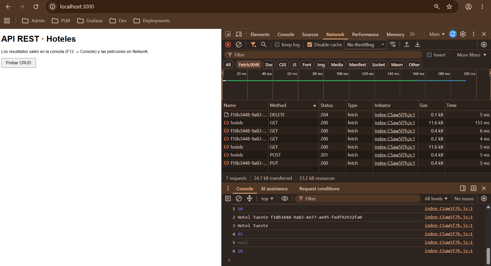
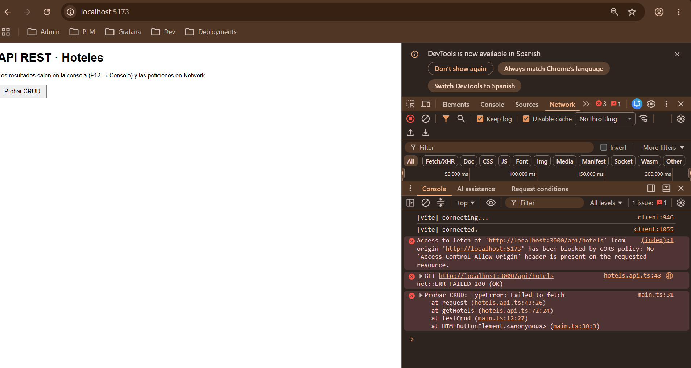
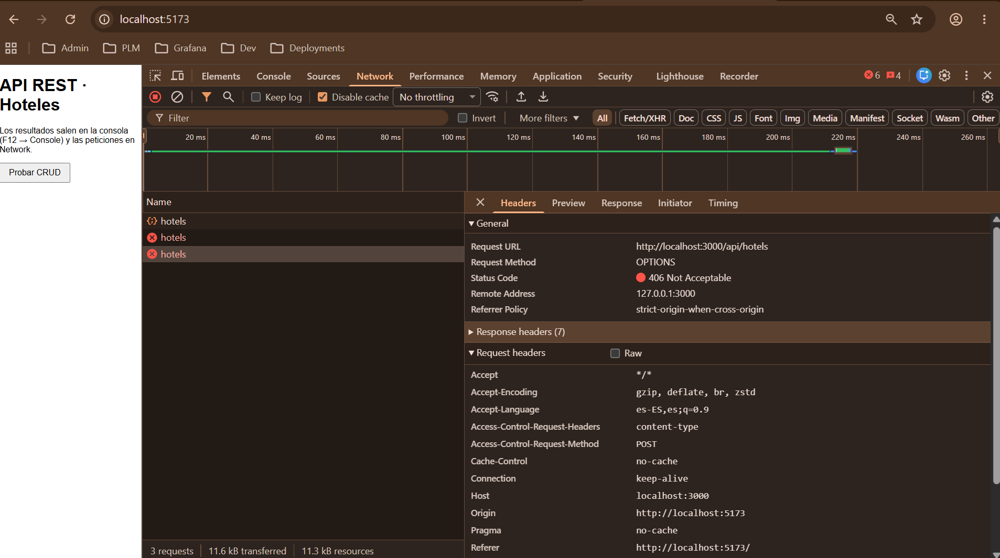
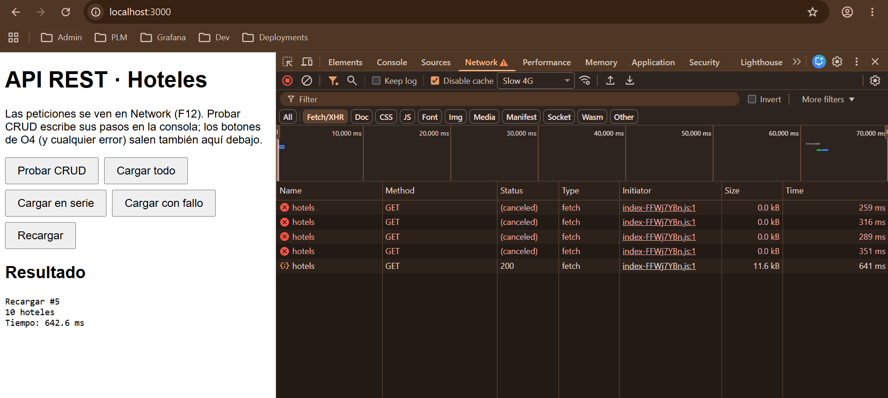
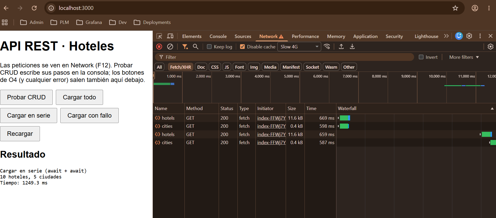

# Lab 05 · API REST

Un cliente en TypeScript (sin framework, con Vite) que hace el CRUD de hoteles
con `fetch` contra el servidor del módulo (`hotels-server`), y se pelea con
CORS y con varias peticiones a la vez.

## Cómo arrancarlo

Necesita Node.js 22.12 o superior (lo pide Vite 8: `^20.19.0 || >=22.12.0`).
El DevContainer usa la imagen `javascript-node:24`.

### Con DevContainer (recomendado)

1. Abre la raíz del repo en VS Code → *Dev Containers: Reopen in Container*.
2. Al crear el contenedor, el `postCreateCommand` instala las dependencias de
   todos los laboratorios, y en este, las de `05-API_REST/hotels-server` y
   `05-API_REST/client` (cada una sólo si existe su `package.json`).
3. Si el contenedor es de antes del lab 5, no tiene ni esas dependencias ni el
   puerto 3000 reenviado. Haz *Dev Containers: Rebuild Container*, o instala
   a mano:
   ```bash
   (cd 05-API_REST/hotels-server && npm install)
   (cd 05-API_REST/client && npm install)
   ```
   (Para tener el puerto 3000 en la pestaña **Ports** hay que reconstruir de
   todas formas, o añadirlo a mano en esa pestaña).
4. Puertos que VS Code reenvía a `localhost` en Windows:

   | Puerto | Qué es |
   | --- | --- |
   | 3000 | `hotels-server`: la API en `/api` y el cliente construido en `/` |
   | 5173 | `npm run dev` del cliente (Vite) |
   | 4173 | `npm run preview` del cliente |

   Los puertos 3000 y 5173 llevan `requireLocalPort: true`. Si alguno ya está
   ocupado en Windows (otro servidor, otro contenedor), VS Code **no** lo
   reenvía a otro puerto en silencio (3001, 5174…): avisa de que no puede.
   Es lo que queremos, porque la URL de la API
   (`http://localhost:3000/api`) y el origen del cliente
   (`http://localhost:5173`, que importa para CORS) tienen que ser
   exactamente esos. Si pasa, cierra lo que esté usando el puerto en Windows
   y vuelve a reenviarlo desde la pestaña **Ports**.

### Servidor

```bash
cd 05-API_REST/hotels-server
npm run dev
```

Escucha en http://localhost:3000 (`tsx watch ./src/index.ts`).

⚠️ Los datos viven en memoria. Cada vez que el servidor se reinicia, los
hoteles vuelven a ser los 10 iniciales. También se reinicia cuando guardas
cualquier fichero suyo, porque `tsx watch` lo vuelve a arrancar. Si rompes
algo, basta con reiniciar.

La carpeta `hotels-server/front/` (la que sirve en `/`) no se sube a git: es
el resultado de `npm run build` en `client`, igual que un `dist`.

### Cliente construido (O2)

Con el servidor arrancado (sin `USE_CORS`), en otra terminal:

```bash
cd 05-API_REST/client
npm run build
```

`build` es `tsc && vite build`: si hay un error de tipos, no se construye.
Después, el `postbuild` borra `hotels-server/front/` y copia ahí `dist/`
(`rm -rf ../hotels-server/front && cp -r dist ../hotels-server/front`).
No hace falta reiniciar el servidor: `express.static` lee los ficheros en
cada petición. Basta con recargar.

Abre http://localhost:3000 (sirve el cliente y la API en el mismo origen) y
F12. El botón **Probar CRUD** hace el recorrido del enunciado (listar, crear
"Hotel Tueste", leerlo, cambiarle el `lowRate` a 95, borrarlo, volver a
leerlo y listar) y escribe cada paso en **Console** (`1 10` … `6 10`). Si
algo falla, el error sale en Console con `console.error`. Como el hotel se
crea y se borra, el botón se puede pulsar varias veces y la cuenta vuelve a
10.

> El `postbuild` de `.start-code` era `cp -r dist/ ../hotels-server/front`.
> Sólo funciona la primera vez: si `front/` ya existe, `cp` copia la carpeta
> **dentro** (`front/dist/…`) y el servidor sigue sirviendo el `index.html`
> viejo. Se vio en el segundo build de O2, y por eso ahora se borra antes de
> copiar.

### Cliente en desarrollo (O3)

```bash
cd 05-API_REST/client
npm run dev
```

Abre http://localhost:5173 (desde el navegador de Windows). El script es
`vite --host`: sin `--host`, Vite sólo escucha en `[::1]` (el `localhost`
IPv6 del contenedor) e imprime `Network: use --host to expose`; con él
escucha en todas las interfaces e imprime
`Network: http://172.17.0.2:5173/`, que es por donde VS Code reenvía el
puerto a Windows.

El cliente saca la URL de la API de `VITE_API_BASE` en
[client/.env](client/.env) (`http://localhost:3000/api`), tipada como
`string` en [client/src/vite-env.d.ts](client/src/vite-env.d.ts). No es un
secreto: Vite la escribe tal cual en el JS que se descarga el navegador. Para
cambiarla sólo en tu máquina, `client/.env.local` (no se sube).

Desde `localhost:5173`, la API (`localhost:3000`) es **otro origen**: sin
CORS en el servidor, el navegador bloquea las respuestas (ver O3).

### Servidor con CORS

```bash
cd 05-API_REST/hotels-server

# En el DevContainer, macOS o Linux
USE_CORS=yes npm run dev

# En Windows (PowerShell, fuera del contenedor)
$env:USE_CORS="yes"; npm run dev
```

Con `USE_CORS=yes` el servidor monta `cors()` en `/api`
([index.ts:22](hotels-server/src/index.ts#L22)) y en `/` sirve `public/` en
vez de `front/` ([index.ts:21](hotels-server/src/index.ts#L21)): el cliente
construido **deja de estar** en http://localhost:3000, así que se usa el de
desarrollo (5173). Para volver al modo de O2, se para y se arranca con
`npm run dev` a secas. (En PowerShell la variable se queda puesta en esa
ventana: `Remove-Item Env:USE_CORS`).

## Estructura

```
05-API_REST/
├── lab.md              enunciado del laboratorio
├── prompts.md          prompts usados con Claude Code, en orden
├── README.md           este fichero
├── bitacora.md         bitácora de IA
├── smoke-api-test.sh   ejemplos de curl del módulo (POST y PUT)
├── docs/               capturas (.png) y salidas de curl (.txt)
├── hotels-server/      servidor del módulo (Express), sin modificar
│   ├── src/            index.ts (rutas y middlewares), middleware.ts, data-layer/
│   ├── public/         miniaturas de los hoteles (estáticos con USE_CORS=yes)
│   └── front/          build del cliente (estáticos sin CORS), ignorado en git
└── client/             cliente TypeScript + Vite
    ├── .env            VITE_API_BASE (URL de la API, no secreta)
    ├── src/            main.ts (botones), hotels.api.ts (request<T>, el CRUD,
    │                   getCities y getNope),
    │                   vite-env.d.ts (tipos de import.meta.env)
    └── public/         favicon e iconos
```

## O1 · Explorar la API

Las 9 peticiones se lanzaron con `curl -s -i`, en este orden y con el servidor
recién arrancado (sin `USE_CORS`). La salida completa, con el comando y las
cabeceras de cada respuesta, está en [docs/o1-curl.txt](docs/o1-curl.txt).
La tabla recoge lo que salió, no lo que dice la teoría.

| Petición | Código de estado | ¿Qué devuelve en el cuerpo? |
| --- | --- | --- |
| GET /api/hotels sin cabecera Accept | **406** Not Acceptable | `{"error":"Not Acceptable"}` (un string, no el objeto de error con `code` y `message` que devuelven los 500) |
| GET /api/hotels con Accept: application/json | 200 OK | `{ data: [...] }`: array con los 10 hoteles, cada uno con los ~30 campos del servidor |
| GET /api/hotels/1 | 200 OK | `{ data: {...} }`: el hotel "Motif Seattle" (`lowRate` 259, `highRate` 289) |
| GET /api/hotels/999 | **200** OK | `{}`: un objeto vacío, **sin** la clave `data` |
| GET /api/cities | 200 OK | `{ data: [...] }`: 5 ciudades `{ id, name }` (Seattle, Chicago, New York, California, Burlingame) |
| POST /api/hotels con un hotel en JSON | 201 Created | `{ data: {...} }`: el hotel enviado más `id` (UUID generado por el servidor), `created` y `modified` |
| PUT /api/hotels/1 cambiando lowRate | 200 OK | `{ data: {...} }`: el hotel 1 completo con `lowRate` 199 y `modified` actualizado |
| DELETE /api/hotels/1 | 204 No Content | Sin cuerpo (ni `Content-Type` ni `Content-Length` en la respuesta) |
| GET /api/hotels/1 después de borrarlo | **200** OK | `{}`, igual que el 999 |

En negrita, los códigos que no son los que dice la teoría (ver abajo).

Para repetirlo (con el servidor recién arrancado; el DELETE borra el hotel 1
hasta que se reinicia):

```bash
B=http://localhost:3000/api

curl -i "$B/hotels"                                            # sin Accept → 406
curl -i -H "Accept: application/json" "$B/hotels"
curl -i -H "Accept: application/json" "$B/hotels/1"
curl -i -H "Accept: application/json" "$B/hotels/999"
curl -i -H "Accept: application/json" "$B/cities"

curl -i -X POST "$B/hotels" \
  -H "Accept: application/json" -H "Content-Type: application/json" \
  -d '{"name":"Grand Hyatt Seattle","city":"Seattle","lowRate":210,"highRate":320}'

curl -i -X PUT "$B/hotels/1" \
  -H "Accept: application/json" -H "Content-Type: application/json" \
  -d '{"lowRate":199}'

curl -i -X DELETE -H "Accept: application/json" "$B/hotels/1"
curl -i -H "Accept: application/json" "$B/hotels/1"            # después del DELETE
```

(Añadid `-s` si lo redirigís a un fichero: sin él, curl mezcla su barra de
progreso con la respuesta.)

⚠️ Los ejemplos de [smoke-api-test.sh](smoke-api-test.sh) no llevan
`Accept: application/json`, así que contra este servidor devuelven todos 406.
Además, sus comentarios dicen que el POST y el PUT devuelven 204; en realidad
devuelven 201 y 200 con el hotel en `{ data: ... }`.

### 🔎 Comprobaciones

**Sin `Accept: application/json` fallan todas las peticiones a `/api`.**
[hotels-server/src/index.ts:18](hotels-server/src/index.ts#L18) monta
`checkContentTypeJSON` con `app.use('/api', …)`, antes de cualquier ruta, así
que se ejecuta en todas las peticiones a `/api` (cualquier método).
En [hotels-server/src/middleware.ts:8](hotels-server/src/middleware.ts#L8) lee
la cabecera `Accept` y en la
[línea 10](hotels-server/src/middleware.ts#L10) la compara con `!==` contra el
texto exacto `"application/json"`; si no coincide, la
[línea 11](hotels-server/src/middleware.ts#L11) responde
`406 {"error":"Not Acceptable"}` y no llama a `next()`, así que la ruta nunca
llega a ejecutarse. Sin la cabecera, `req.get("Accept")` es `undefined` y
falla. Pero también falla con un `Accept` válido que no sea exactamente ese
texto: `Accept: application/json, text/plain, */*` (el que envía axios por
defecto) también recibe 406 (petición E1 de
[docs/o1-curl.txt](docs/o1-curl.txt)). Por eso el cliente tendrá que enviar
siempre `Accept: application/json`, tal cual.

**Los datos vienen dentro de `{ "data": ... }`.** Todas las respuestas con
éxito y cuerpo hacen `res.json({ data })`:
[index.ts:31](hotels-server/src/index.ts#L31) (lista de hoteles),
[:48](hotels-server/src/index.ts#L48) (POST, con `status(201)`),
[:63](hotels-server/src/index.ts#L63) (ciudades),
[:79](hotels-server/src/index.ts#L79) (un hotel) y
[:96](hotels-server/src/index.ts#L96) (PUT). En las respuestas reales se ve
`{"data":[{"id":"1",…` y `{"data":{"id":"1",…`. Los errores, en cambio, van
en `error` (`{"error":"Not Acceptable"}` en el 406). En el front, `request<T>`
tendrá que devolver `body.data`, no el cuerpo entero.

**Respuestas que no son las que dice la teoría** (concepto 01, "Common HTTP
Response Status Codes"):

| Petición | Debería devolver | Devuelve |
| --- | --- | --- |
| GET /api/hotels/999 | 404 Not Found: el recurso no existe | 200 OK con `{}` |
| GET /api/hotels/1 después del DELETE | 404 Not Found | 200 OK con `{}` |
| GET /api/hotels sin Accept, o con `Accept: application/json, text/plain, */*` | 200: sin `Accept` el cliente acepta cualquier tipo, y `*/*` lo incluye. 406 es sólo para cuando el servidor no puede producir **ningún** tipo de los que se piden | 406 Not Acceptable |
| PUT /api/hotels/999 (extra, E2) | 404 Not Found | 200 OK con `{"data":null}` |
| DELETE /api/hotels/999 (extra, E3) | 404 Not Found | 204 No Content, como si lo hubiera borrado |

El origen de los cuatro casos "no existe" es el mismo: ninguna ruta mira lo
que devuelve el repositorio. `findById` devuelve `undefined`
([hotel.repo.ts:90](hotels-server/src/data-layer/hotel.repo.ts#L90)),
`update` devuelve `null`
([hotel.repo.ts:100](hotels-server/src/data-layer/hotel.repo.ts#L100)) y
`delete` devuelve `false`
([hotel.repo.ts:117](hotels-server/src/data-layer/hotel.repo.ts#L117), y
[index.ts:111](hotels-server/src/index.ts#L111) ni lo guarda), y las rutas
responden con éxito igualmente. Arreglarlo es el desafío D1; en los
obligatorios el servidor no se toca.

**Cómo se detecta que un hotel no existe** (lo necesita `getHotel` en O2).
Por el código, no se puede: el GET de un hotel que no existe es un 200, igual
que el de uno que sí, así que `response.ok` es `true`. La diferencia está en
el cuerpo: `findById` devuelve `undefined`
([hotel.repo.ts:90](hotels-server/src/data-layer/hotel.repo.ts#L90)),
[index.ts:79](hotels-server/src/index.ts#L79) hace `res.json({ data: undefined })`,
y `JSON.stringify` quita las claves con valor `undefined`, así que lo que
llega es `{}`, sin la clave `data`. Comprobado con el `fetch` de Node: en el
999, `status` 200, `ok` `true`, el cuerpo `{}` y `body.data` `undefined`.
Así que, para este servidor: **si el cuerpo no trae `data`, el hotel no
existe** y `getHotel` devolverá `null`. Ojo, el PUT de un hotel que no existe
es distinto: devuelve `{"data":null}` (el `null` sí sobrevive al JSON).

## O2 · Cliente con fetch

### Qué hay en `client/src/hotels.api.ts`

- **`Hotel`** (`id`, `name`, `city`, `lowRate`, `highRate`) y
  **`NewHotel = Omit<Hotel, "id">`**: sólo los campos que usa el front, no
  los ~30 del servidor.
- **`API_BASE = "/api"`**: URL relativa, porque el cliente construido lo
  sirve el mismo servidor (mismo origen). En O3 pasa a `VITE_API_BASE`
  (`import.meta.env.VITE_API_BASE`, `http://localhost:3000/api`).
- **`Envelope<T> = { data?: T }`**: la forma de las respuestas. `data` es
  opcional porque a veces falta (el `{}` del 999).
- **`request<T>(path, options)`**: la única función que llama a `fetch`.
  Devuelve `Promise<T | undefined>`.
- **`requireData(data, what)`**: para las llamadas que siempre tienen que
  traer `data`. Si llega `undefined`, lanza un `Error` en vez de dejar pasar
  un `undefined` silencioso.
- Las cinco funciones, con el tipo de retorno anotado:

  | Función | Petición | Éxito | Devuelve |
  | --- | --- | --- | --- |
  | `getHotels()` | `GET /api/hotels` | 200 | `Promise<Hotel[]>` (con `requireData`) |
  | `getHotel(id)` | `GET /api/hotels/:id` | 200 (también si no existe) | `Promise<Hotel \| null>`: `null` si el cuerpo no trae `data` |
  | `createHotel(hotel: NewHotel)` | `POST /api/hotels` con el hotel en JSON | 201 | `Promise<Hotel>`: el hotel con el `id` del servidor |
  | `updateHotel(id, changes: Partial<NewHotel>)` | `PUT /api/hotels/:id` con los cambios en JSON | 200 | `Promise<Hotel>`: el hotel completo ya cambiado |
  | `deleteHotel(id)` | `DELETE /api/hotels/:id` | 204 | `Promise<void>` |

**Cabeceras.** `request` parte de las que lleguen en `options.headers` (con
`new Headers(...)`, que acepta objeto, array o `Headers`) y sólo añade las
que falten, para no pisarlas: `Accept: application/json` siempre, y
`Content-Type: application/json` sólo si hay `body` (POST y PUT). Un GET o
un DELETE no llevan `Content-Type`, porque no envían nada que describir.

**El tipo de la respuesta.** `response.json()` devuelve `any`. Se guarda en
una variable anotada, `const body: Envelope<T> = await response.json()`.
TypeScript lo acepta porque `any` se puede asignar a cualquier tipo, sin
`as` ni `any` explícito. Pero **ahí TypeScript se fía del servidor sin
comprobar nada** (lo dice un comentario en el código): si el servidor
mandase `lowRate: "barato"`, el tipo seguiría diciendo `number`. Validarlo
en ejecución es P5 (Zod). La otra opción era leerlo como `unknown` y
pasarlo por una guarda `body is { data: T }`. Se descartó porque esa guarda
sólo puede mirar que exista `data`, no que sea un `T`: dice más de lo que
comprueba, igual que un `as`.

**Por qué `T | undefined`.** En un 204 hay que devolver algo sin leer el
cuerpo, y `undefined` no se puede asignar a un `T` genérico sin `as`. En
lugar de esconderlo, el tipo lo dice: `request` devuelve `undefined` en un
204 **y** cuando el cuerpo no trae `data`, que es justo el caso del hotel que
no existe. Así `getHotel` se queda en `(await request<Hotel>(…)) ?? null`, y
las demás pasan por `requireData`.

### Qué hace `request<T>` en cada caso

Comprobado con el `hotels.api.ts` real ejecutado en Node (Node 22 quita los
tipos al importar un `.ts`). Para que la URL relativa funcione fuera del
navegador, la prueba envuelve `fetch` para que anteponga
`http://localhost:3000`.

| Caso | Qué pasa en `fetch` | Qué hace `request<T>` | Qué ve quien llama |
| --- | --- | --- | --- |
| **200 / 201 con `data`** | resuelve, `ok` `true` | `response.json()` y devuelve `body.data` | el dato (`1 10`, `2 Hotel Tueste <uuid>`, `4 95`…) |
| **200 con `{}`** (hotel que no existe) | resuelve, `ok` `true` | devuelve `body.data`, que es `undefined` | `getHotel` → `null` (`5 null`) |
| **204** (DELETE) | resuelve, `ok` `true` | devuelve `undefined` **sin** llamar a `response.json()` | `deleteHotel` → `void` |
| **404** (p. ej. `/api/nope`) | resuelve, `ok` `false` | lanza `Error: GET /api/nope → 404 Not Found` | el `await` rechaza → `catch` |
| **406** (sin `Accept`) | resuelve, `ok` `false` | lanza `Error: GET /api/hotels → 406 Not Acceptable` | el `await` rechaza → `catch` |
| **Error de red** (servidor parado) | **rechaza** con `TypeError` (Chrome: `Failed to fetch`; Node: `fetch failed`, `cause` `ECONNREFUSED`) | no llega a mirar `ok`: el `TypeError` sube tal cual | el `await` rechaza → `catch` |

En `main.ts`, el listener del botón llama a `testCrud().catch(error =>
console.error("Probar CRUD:", error))`. `addEventListener` no espera a la
promesa, así que sin ese `catch` cualquiera de estos errores acabaría como
`Uncaught (in promise)`.

### El recorrido, con curl

Con el servidor recién arrancado, la misma secuencia que hace el botón, con
las mismas cabeceras. Está completa en [docs/o2-curl.txt](docs/o2-curl.txt):

| # | Petición | Código | Salida en Console |
| --- | --- | --- | --- |
| 1 | `GET /api/hotels` | 200 | `1 10` |
| 2 | `POST /api/hotels` `{"name":"Hotel Tueste","city":"Seattle","lowRate":90,"highRate":120}` | **201** Created | `2 Hotel Tueste ed596e79-…` |
| 3 | `GET /api/hotels/<id>` | 200 | `3 Hotel Tueste` |
| 4 | `PUT /api/hotels/<id>` `{"lowRate":95}` | 200 | `4 95` |
| 5 | `DELETE /api/hotels/<id>` | **204** No Content | (nada) |
| 6 | `GET /api/hotels/<id>` | 200 con `{}` | `5 null` |
| 7 | `GET /api/hotels` | 200 | `6 10` |

Después se reinició el servidor y se lanzó el recorrido con el
`hotels.api.ts` real (en Node). Sacó lo mismo: `1 10`,
`2 Hotel Tueste 2e1a26f5-…`, `3 Hotel Tueste`, `4 95`, `5 null`, `6 10`. El
log del servidor (`morgan`) registró `200, 201, 200, 200, 204, 200, 200`.
Las cabeceras que envió cada petición: `Accept: application/json` en las 7, y
`Content-Type: application/json` sólo en el POST y el PUT.

### Lo que se ve en Network

En http://localhost:3000, F12 → Network, filtro **Fetch/XHR**, al pulsar
**Probar CRUD**:

- **7 peticiones**: `hotels` GET 200, `hotels` POST **201**, `<uuid>` GET 200,
  `<uuid>` PUT 200, `<uuid>` DELETE **204**, `<uuid>` GET 200 y `hotels` GET
  200. No hay ninguna OPTIONS: es el mismo origen y no hay CORS (eso es O3).
- **Payload del POST**: *Request Payload*
  `{"name":"Hotel Tueste","city":"Seattle","lowRate":90,"highRate":120}`,
  sin `id`. En *Headers* → *Request Headers*: `Accept: application/json` y
  `Content-Type: application/json`. En *Response*:
  `{"data":{…,"id":"<uuid>","created":…,"modified":…}}`.
- **DELETE**: en *Response* no hay nada ("This request has no response
  data available"), y en *Response Headers* no hay `Content-Type`.
- **El GET después del DELETE**: 200, y en *Response* sólo `{}`. Network
  no lo marca en rojo, aunque el hotel ya no existe.
- **Sin `Accept`**: se probó quitando de `request` el bloque que lo pone y
  recompilando. Sin esa cabecera, `fetch` (y curl) mandan `Accept: */*`, y el
  servidor responde **406** `{"error":"Not Acceptable"}`. El recorrido se para
  en el primer paso: en Network sólo sale un GET `hotels` **406** (en rojo), y
  en Console, `Probar CRUD: Error: GET /api/hotels → 406 Not Acceptable`. Ni
  un `undefined` ni un `1 undefined`. Después se volvió a poner el bloque y
  se recompiló: el fichero quedó idéntico (`cmp`) y el JS construido vuelve a
  llevar el `Accept`.

## O3 · CORS

En este obligatorio CORS **no se arregla** (ni en el servidor, que es D1, ni
con el proxy de Vite, que es P2, ni con `mode: "no-cors"`): se provoca, se
observa y se explica.

### La URL base, de una variable de entorno

[hotels.api.ts](client/src/hotels.api.ts) hace
`const API_BASE = import.meta.env.VITE_API_BASE;`, que vale
`http://localhost:3000/api` ([client/.env](client/.env)). La URL es ahora
absoluta, así que el mismo código llama siempre a `localhost:3000`, se abra
desde donde se abra:

- Desde el **build** servido en http://localhost:3000 (O2): mismo origen.
  Comprobado: `npm run build` pasa, el JS construido lleva
  `http://localhost:3000/api`, y el recorrido de **Probar CRUD** con el
  `hotels.api.ts` real (cargado con `ssrLoadModule` de Vite, que sustituye
  `import.meta.env` igual que el build) da `1 10` … `6 10`, con las 7
  peticiones a `http://localhost:3000/api/…`.
- Desde **`npm run dev`** en http://localhost:5173: otro origen. Mismo
  esquema (`http`) y mismo host (`localhost`), pero **otro puerto**, y el
  origen es los tres juntos.

`VITE_API_BASE` está tipada en
[vite-env.d.ts](client/src/vite-env.d.ts) (`readonly VITE_API_BASE: string`).
Comprobado que es `string` y no `any`: asignarla a un `number` hace fallar
`tsc` con `Type 'string' is not assignable to type 'number'`.

### Sin CORS y con CORS, con curl

La salida completa (comandos, cabeceras y el log de `morgan` de cada
arranque) está en [docs/o3-curl.txt](docs/o3-curl.txt). curl manda las mismas
cabeceras que mandaría Chrome desde `localhost:5173`, pero **no aplica la
política CORS**: enseña la respuesta entera y la decisión de bloquear queda
para el navegador.

| | Petición | Respuesta | `Access-Control-*` | ¿El navegador deja leerla? |
| --- | --- | --- | --- | --- |
| a) sin CORS | `GET /api/hotels`, `Origin: http://localhost:5173`, `Accept: application/json` | **200** con los 10 hoteles | ninguna | **No**: falta `Access-Control-Allow-Origin` |
| b) `USE_CORS=yes` | el mismo GET | **200** con los 10 hoteles | `Access-Control-Allow-Origin: *` | Sí |
| c) `USE_CORS=yes` | preflight del POST: `OPTIONS /api/hotels`, `Origin`, `Access-Control-Request-Method: POST`, `Access-Control-Request-Headers: content-type` (sin `Accept: application/json`) | **406** `{"error":"Not Acceptable"}` | ninguna | **No**, y el POST no llega a enviarse |

En los tres casos la petición **llega** al servidor, que la registra:
`GET /api/hotels 200` (a y b) y `OPTIONS /api/hotels 406` (c). El servidor
responde siempre; quien bloquea es el navegador.

Contraprueba (c2 en el fichero, y esto **no** lo hace el navegador): el
mismo OPTIONS pero añadiendo `Accept: application/json` responde **204** con
`Access-Control-Allow-Origin: *`,
`Access-Control-Allow-Methods: GET,HEAD,PUT,PATCH,POST,DELETE` y
`Access-Control-Allow-Headers: content-type`. Es decir, `cors()` sabe
contestar el preflight; lo que falla es que la petición no llega hasta él.

### Por qué el OPTIONS responde 406

El orden de los middlewares en
[hotels-server/src/index.ts](hotels-server/src/index.ts) es:

| Línea | Middleware | Con el preflight (`OPTIONS`, `Accept: */*`) |
| --- | --- | --- |
| [16](hotels-server/src/index.ts#L16) | `morgan("dev")` | lo registra y sigue |
| [17](hotels-server/src/index.ts#L17) | `express.json()` | no hay cuerpo JSON: sigue |
| [18](hotels-server/src/index.ts#L18) | `app.use('/api', checkContentTypeJSON)` | **responde 406 y corta** |
| [22](hotels-server/src/index.ts#L22) | `app.use("/api", cors())` (sólo con `USE_CORS`) | nunca se ejecuta |

1. `checkContentTypeJSON` está montado con `app.use`, que vale para
   **cualquier método**, también `OPTIONS`, y **antes** que `cors()`
   (línea 18 frente a línea 22). Express ejecuta los middlewares en el orden
   en que se registran.
2. El preflight lo genera el navegador, no nuestro código: lleva `Origin`,
   `Access-Control-Request-Method: POST` y
   `Access-Control-Request-Headers: content-type`, y como `Accept` el
   genérico `*/*`. El `Accept: application/json` que pone `request<T>` va en
   el POST de verdad, no en el preflight. **Falta, por tanto,
   `Accept: application/json`**.
3. En [middleware.ts:8](hotels-server/src/middleware.ts#L8) se lee
   `Accept` (`*/*`), en la [línea 10](hotels-server/src/middleware.ts#L10)
   se compara con `!==` contra `"application/json"` y no coincide, y la
   [línea 11](hotels-server/src/middleware.ts#L11) hace
   `return res.status(406).json(...)` **sin llamar a `next()`**.
4. Como la cadena se corta ahí, `cors()` no llega a ejecutarse: la respuesta
   del preflight sale con 406 y **sin ninguna cabecera
   `Access-Control-*`**.

El GET con CORS sí funciona aunque pase por el mismo middleware, porque lleva
`Accept: application/json` (lo pone `request<T>`): pasa la línea 18, llega a
`cors()`, que añade `Access-Control-Allow-Origin: *`, y después a la ruta.
Arreglarlo (que el preflight llegue a `cors()`) es el desafío D1.

### Los mensajes de consola

El del GET está deducido de la respuesta a de curl; el del POST es el que
muestra Chrome (copiado de la consola):

**GET sin CORS** (respuesta a, sin `Access-Control-Allow-Origin`):

```
Access to fetch at 'http://localhost:3000/api/hotels' from origin 'http://localhost:5173' has been blocked by CORS policy: No 'Access-Control-Allow-Origin' header is present on the requested resource. If an opaque response serves your needs, set the request's mode to 'no-cors' to fetch the resource with CORS disabled.
```

La última frase la añade Chrome cuando la petición es un `fetch`, y es la
trampa de la bitácora del enunciado: con `mode: "no-cors"` el error
desaparece, pero la respuesta llega opaca (`status` 0, sin cuerpo ni
cabeceras), así que `request<T>` no podría leer ni el código ni el `data`.

**POST con CORS** (respuesta c, preflight con 406):

```
Access to fetch at 'http://localhost:3000/api/hotels' from origin 'http://localhost:5173' has been blocked by CORS policy: Response to preflight request doesn't pass access control check: No 'Access-Control-Allow-Origin' header is present on the requested resource.
hotels.api.ts:43  POST http://localhost:3000/api/hotels net::ERR_FAILED
```

La respuesta del preflight tiene **dos** fallos: el estado (406, que no es
2xx) y la falta de `Access-Control-Allow-Origin`. Chrome sólo informa de
uno, y es el de la cabecera: el mensaje no dice nada del 406, que sólo se ve
en Network (o en el log del servidor). La segunda línea es la del `fetch`
que ha fallado ([hotels.api.ts:43](client/src/hotels.api.ts#L43)), sin
código de estado, porque el POST no llegó a tener respuesta: ni siquiera se
envió.

En los dos casos `fetch` rechaza con `TypeError: Failed to fetch`: no llega a
haber `response`, así que `request<T>` no llega al `if (!response.ok)` y el
`TypeError` sube tal cual hasta el `catch` de `main.ts`
(`Probar CRUD: TypeError: Failed to fetch`). Desde JS es indistinguible de un
error de red: el detalle sólo está en la consola, a propósito, para que una
página no pueda usar los errores de CORS para averiguar qué hay en otro
origen.

### Qué pasa al pulsar Probar CRUD en localhost:5173

- **Sin CORS**: se para en el paso 1. El GET llega al servidor y responde
  200, pero el navegador no deja leer la respuesta. El POST y los demás ni
  se envían.
- **Con `USE_CORS=yes`**: el paso 1 funciona (`1 10`). En el paso 2, antes
  del POST, el navegador manda el OPTIONS; recibe 406 y **el POST no se
  envía**: el log del servidor sólo registra `GET 200` y `OPTIONS 406`.
  La consola de Chrome, completa:

  ```
  main.ts:12 1 10
  (index):1 Access to fetch at 'http://localhost:3000/api/hotels' from origin 'http://localhost:5173' has been blocked by CORS policy: Response to preflight request doesn't pass access control check: No 'Access-Control-Allow-Origin' header is present on the requested resource.
  hotels.api.ts:43  POST http://localhost:3000/api/hotels net::ERR_FAILED
  main.ts:31 Probar CRUD: TypeError: Failed to fetch
      at request (hotels.api.ts:43:26)
      at createHotel (hotels.api.ts:85:25)
      at testCrud (main.ts:13:25)
  ```

  La pila confirma el recorrido del error: `fetch` rechaza dentro de
  `request` (línea 43), sin llegar al `if (!response.ok)`; el `TypeError`
  sube sin tocar por `createHotel` y `testCrud`, y lo recoge el `catch` del
  listener en `main.ts`. Ni rastro del 406: para el código JS es igual que un
  error de red.

## O4 · Varias peticiones

Se prueba en el modo de O2: servidor sin `USE_CORS`, `npm run build` en
`client` y http://localhost:3000. Hay cuatro botones nuevos junto a
**Probar CRUD**. Cada uno escribe su resultado en la página (un
`<pre id="result" aria-live="polite">`, que el lector de pantalla anuncia al
cambiar) y en la consola.

En [hotels.api.ts](client/src/hotels.api.ts) hay tres cosas nuevas:

- `City` (`id`, `name`: lo que trae `GET /api/cities`, ver
  [docs/o1-curl.txt](docs/o1-curl.txt)) y `getCities()`.
- `getHotels(signal?: AbortSignal)`. `request` no ha cambiado de firma: la
  señal le llega en `options.signal`, porque `RequestInit` ya la tiene, y el
  `...options` se la pasa a `fetch`. Las llamadas de O2 (`getHotels()`)
  siguen funcionando igual.
- `getNope()`: pide `/api/nope` pasando por `request`, así que el 404 sale con
  el mismo error que cualquier otro. `request` sigue siendo privado:
  exportarlo permitiría a `main.ts` pedir cualquier ruta con sus propias
  cabeceras, y `hotels.api.ts` dejaría de ser el único sitio que habla con
  la API.

Lo que responde `/api/nope` (curl, en [docs/o4-curl.txt](docs/o4-curl.txt)):
con `Accept: application/json`, **404** `Not Found` con un **HTML** de
Express (`<pre>Cannot GET /api/nope</pre>`), no JSON. Sin `Accept`,
**406** `{"error":"Not Acceptable"}`: `checkContentTypeJSON` se ejecuta en
`/api` antes de buscar la ruta. Como `request` lanza en cuanto ve
`!response.ok`, no llega a intentar leer ese HTML como JSON.

### Los botones

| Botón | Peticiones | Qué enseña |
| --- | --- | --- |
| **Cargar todo** | `GET /api/hotels` y `GET /api/cities` a la vez, con `Promise.all` | `10 hoteles, 5 ciudades` y el tiempo |
| **Cargar en serie** | las mismas dos, `await getHotels()` y después `await getCities()` | lo mismo, para comparar el tiempo |
| **Cargar con fallo** | 1) hoteles, ciudades y `/api/nope` con `Promise.all`; 2) las tres otra vez con `Promise.allSettled` | 1) sólo el error; 2) los dos que van bien y el que no, con su motivo |
| **Recargar** | `GET /api/hotels` con un `AbortController`; cada clic aborta el anterior | `Recargar #n` con los hoteles y el tiempo de la última |

Las dos peticiones de **Cargar todo** salen al **construir** el array
(`[getHotels(), getCities()]`): llamar a la función ya hace el `fetch`.
`Promise.all` no lanza nada, sólo espera. En **Cargar en serie**,
`getCities()` no se llama hasta que el `await getHotels()` ha terminado.

Por la misma razón, **Cargar con fallo** escribe el array dos veces y no lo
guarda en una variable "para luego". Con
`const requests = [getHotels(), getCities(), getNope()]` arriba del todo, las
tres peticiones saldrían en ese momento, y el `allSettled` reutilizaría las
mismas promesas, ya terminadas, sin hacer peticiones nuevas. Para tener
peticiones que se lanzan más tarde hay que guardar funciones
(`[() => getHotels(), …]`). Aquí no hace falta: cada versión lanza las suyas
en la línea en que las espera.

### Tiempos

Medidos con un script de Node (`fetch` y `performance.now()` globales, como
en el navegador) contra el servidor arrancado esa misma tarde y sin datos
cambiados (10 hoteles, 5 ciudades). Se hicieron 20 ejecuciones de cada
versión, alternadas (paralelo, serie, paralelo…) para que las dos sufran
igual cualquier cambio de carga de la máquina, y antes una de calentamiento
de cada una, que no cuenta (la primera abre la conexión). Cada ejecución
hace las dos peticiones con `Accept: application/json` y lee el JSON, como
el cliente. Salida completa: [docs/o4-tiempos.txt](docs/o4-tiempos.txt).

| Versión | Mediana | Mínimo | Máximo |
| --- | --- | --- | --- |
| En paralelo (`Promise.all`) | 2,32 ms | 1,35 ms | 4,88 ms |
| En serie (`await` + `await`) | 3,19 ms | 1,53 ms | 5,22 ms |

La diferencia es de menos de un milisegundo, porque en `localhost` casi no
hay nada que esperar. No hay red de por medio (ni latencia ni ancho de
banda que repartir), la conexión ya está abierta (keep-alive) y el servidor
responde desde memoria. Cada petición tarda uno o dos milisegundos, y buena
parte de ese tiempo lo pasa el cliente leyendo JSON, que es trabajo que no
se solapa. Además, el servidor es un solo proceso de Node: en paralelo, las
dos peticiones llegan a la vez, pero las atiende una detrás de otra (son
microsegundos). Por eso la serie no tarda el doble, sino algo más de 1,3
veces.

Con una red lenta todo cambia, porque lo que domina es la **espera**: cada
petición pasa cientos de milisegundos viajando. Las esperas en serie se
**suman**, y en paralelo se **solapan**, así que cuenta sólo la más lenta.
Si cada una tardase 500 ms, serían unos 1000 ms en serie y unos 500 ms en
paralelo. En Network, con Slow 4G, se ve en la columna Waterfall (captura
opcional `o4-waterfall.png`).

### Promise.all y Promise.allSettled ante el 404

En la página, tras pulsar **Cargar con fallo**:

```
Cargar con fallo
1) Promise.all
   → catch: GET http://localhost:3000/api/nope → 404 Not Found
2) Promise.allSettled
   ✔ hoteles: 10
   ✔ ciudades: 5
   ✘ /api/nope: GET http://localhost:3000/api/nope → 404 Not Found
```

- **`Promise.all`** rechaza en cuanto rechaza una, con el motivo de esa, y
  nunca llega a la línea que cuenta hoteles y ciudades. Los datos de las
  dos que han ido bien se pierden. Pero esas peticiones **no se cancelan**:
  en Network, `hotels` y `cities` acaban con 200 aunque el código ya no las
  espere. `Promise.all` no aborta nada; para eso habría que pasarles a las
  tres la misma señal y abortarla en el `catch`.
- **`Promise.allSettled`** espera a las tres y nunca rechaza. Devuelve un
  `PromiseSettledResult` por petición, en el mismo orden:
  `{ status: "fulfilled", value }` o `{ status: "rejected", reason }`.
  TypeScript sabe el tipo de cada posición (`value` es `Hotel[]` en la
  primera y `City[]` en la segunda), y `describe` mira el `status` antes de
  tocar `value` o `reason`.

En Network salen seis peticiones: `hotels` 200, `cities` 200 y `nope` 404
(en rojo), dos veces.

### La cancelación (Recargar)

Es el patrón "Cancelling Previous Requests" de la demo 05. El controlador de
la petición en curso vive **fuera** de la función (`reloadController`),
para que el siguiente clic lo encuentre:

1. Cada clic hace primero `reloadController?.abort()`, que aborta la
   petición anterior si todavía está en marcha. Si ya terminó, no pasa nada.
2. Crea un `AbortController` nuevo, lo guarda como el actual y llama a
   `getHotels(controller.signal)`.
3. La petición abortada rechaza en el `await` con un `DOMException` de
   nombre `AbortError` (comprobado en Node: `e instanceof DOMException` es
   `true` y `e.name` es `"AbortError"`). `isAbortError` lo reconoce sin `as`
   (`error instanceof DOMException && error.name === "AbortError"`). Esa
   rama sólo hace `console.info("Recargar #n: cancelada…")` y `return`: ni
   error en la página ni `console.error`. Cualquier otro error se relanza y
   lo enseña `onClick`.
4. En el `finally`, el controlador se borra sólo si sigue siendo el suyo.
   Si ya hay otra petición en curso, el actual es el de esa, y no se toca.

Sólo se pinta la última porque las anteriores nunca llegan a la línea que
pinta: rechazan con el `AbortError`. Una petición que ya ha terminado no se
puede abortar, pero tampoco hace falta. Desde que llega su JSON hasta que
pinta, todo son continuaciones de `await` (microtareas), y un clic es un
evento que espera a que terminen. Así que, si la anterior ya ha pintado, la
nueva la pisa al acabar. Cada resultado lleva el número de clic
(`Recargar #5`) para que se vea cuál ha ganado.

En Network, con Slow 4G y cinco clics seguidos: cuatro `hotels` con Status
**(canceled)** y la quinta con 200.

## Respuestas

### O1

> ¿Qué código debería devolver `GET /api/hotels/999` según el concepto 01
> ("Common HTTP Response Status Codes")? ¿Qué devuelve este servidor? ¿Qué
> problema le causa eso al front?

Debería devolver **404 Not Found**, porque el recurso `/api/hotels/999` no
existe. Este servidor devuelve **200 OK** con el cuerpo `{}`. Para el front es
un problema porque un 200 no cae en `!response.ok`: el `fetch` no lanza, el
`if (!response.ok)` no salta, y si se devuelve `body.data` sin mirar nada más,
llega `undefined` (o, si se usase el cuerpo tal cual, un objeto vacío que se
pintaría como un hotel sin nombre, ciudad ni precio) en vez de un mensaje de
"no encontrado". Por eso `getHotel` tiene que comprobar a mano que el cuerpo
trae `data` y devolver `null` si no.

> ¿Por qué el DELETE no devuelve cuerpo? ¿Qué código lo indica?

Porque después de borrar no queda ningún recurso que devolver: la operación ha
ido bien y no hay nada más que contar. Lo indica el **204 No Content**
([index.ts:112](hotels-server/src/index.ts#L112), `res.status(204).send()`):
en la respuesta real no hay ni `Content-Type` ni `Content-Length`. Para el
front significa que no se puede llamar a `response.json()`: comprobado con el
`fetch` de Node, en un 204 lanza `SyntaxError: Unexpected end of JSON input`.
Por eso `request<T>` no lee JSON cuando el estado es 204.

> El concepto 02 recomienda envolver las respuestas en un objeto
> (`{ "data": ... }`). ¿Qué ventaja tiene frente a devolver el array
> directamente?

Que la respuesta puede crecer sin romper a los clientes: junto a `data` se
pueden añadir después `meta` (total, página, enlaces de paginación) y quien
lee `body.data` sigue funcionando; con un array suelto, añadir el total
obligaría a cambiar la forma de la respuesta. Además da una forma fija a todas
las respuestas: aquí lo correcto viene en `data` (`{"data":[…]}`,
`{"data":{…}}`) y lo que falla en `error` (`{"error":"Not Acceptable"}`), así
que una sola función (`request<T>`) puede tratar todas las llamadas igual.
Hasta el 999 se detecta gracias a eso: la clave `data` falta.

### O2

> `fetch` no lanza un error con un 404 o un 500. ¿Cuándo sí lanza? ¿Qué
> pasaría en vuestra aplicación si no comprobaseis `response.ok`?

`fetch` sólo rechaza cuando **no hay respuesta HTTP que entregar**. Para
`fetch`, un 404 o un 500 son respuestas válidas: el servidor ha contestado, y
qué significa ese código lo decide la aplicación. Rechaza en estos casos:

- **Error de red**: servidor parado, DNS que no resuelve, sin conexión.
  Rechaza con `TypeError`. Comprobado contra un puerto sin nadie escuchando:
  `TypeError: fetch failed` con `cause` `ECONNREFUSED` (en Chrome el mensaje
  es `Failed to fetch`).
- **Respuesta bloqueada por CORS**: también `TypeError`, y el código no ve
  ni el estado (es O3).
- **Petición cancelada** con un `AbortController`: `AbortError` (es O4).
- **Petición mal formada** antes de enviarla, p. ej. un GET con `body` o una
  URL inválida: `TypeError`.

Si no se comprobase `response.ok`, los errores del servidor se leerían como
datos. Con el 406, `response.json()` da `{"error":"Not Acceptable"}` y
`body.data` es `undefined`. `getHotel` devolvería entonces `null`, es decir,
"ese hotel no existe", cuando en realidad la petición ha fallado (pasaría lo
mismo con un 500, que trae `{"error":{…}}`). En `getHotels`, `requireData`
lanzaría `GET /api/hotels: la respuesta no trae data`, que apunta a otra
cosa y no dice el código. Sin `requireData` sería peor: llegaría
`undefined`, y `(await getHotels()).length` reventaría con `TypeError:
Cannot read properties of undefined`, lejos de la causa. Y con un 404 de
Express, que responde HTML (`Content-Type: text/html`, `Cannot GET
/api/nope`), `response.json()` lanzaría `SyntaxError`. Comprobando `ok`, el error sale
donde se produce y con lo que hace falta para entenderlo:
`GET /api/hotels → 406 Not Acceptable`.

> ¿Por qué `createHotel` no envía el `id`? ¿Quién lo decide?

Porque el `id` lo decide el **servidor**: lo crea en el POST, y el cliente
no tiene forma de saber qué ids están libres (otro cliente podría haber
usado el mismo). En
[hotel.repo.ts:66-72](hotels-server/src/data-layer/hotel.repo.ts#L66-L72),
`create` recibe un `CreateHotelDTO = Omit<Hotel, 'id' | 'created' | 'modified'>`
y construye `{ ...data, id: crypto.randomUUID(), created, modified }`. Como
el `id` va después del spread, aunque el cliente mandase uno, el servidor lo
pisaría. Por eso `createHotel` recibe un `NewHotel` (`Omit<Hotel, "id">`):
TypeScript ni deja pasarlo. El `id` llega en la respuesta del 201
(`{"data":{…,"id":"ed596e79-…"}}`), y por eso el recorrido usa
`created.id` en los pasos siguientes. Es lo que dice REST: con
`POST /api/hotels` se crea un recurso dentro de la colección, y es el
servidor quien le da su URL (`/api/hotels/<uuid>`).

### O3

> ¿Quién bloquea la respuesta en la comprobación 1: el servidor o el
> navegador? ¿Por qué curl no tenía este problema en O1?

El **navegador**. El servidor recibe el GET y responde 200 con los 10
hoteles: lo dice su log (`GET /api/hotels 200 … - 11332`) y lo enseña curl
con el mismo `Origin` (caso a de [docs/o3-curl.txt](docs/o3-curl.txt)). Los
datos llegan hasta el navegador; es él quien, al ver que la página es de
`http://localhost:5173` y la respuesta de `http://localhost:3000` (otro
puerto, otro origen) **sin** `Access-Control-Allow-Origin`, aplica la
política del mismo origen y no se la entrega al código: `fetch` rechaza con
`TypeError: Failed to fetch`.

curl no tenía este problema porque CORS es una regla **del navegador**, no
de HTTP. La política del mismo origen protege al usuario: impide que una
página que tiene abierta lea, con sus cookies y su sesión, lo que otro
origen le devuelve. curl no es una página, no tiene origen ni la sesión de
nadie, así que no hay nada que proteger: hace la petición y enseña la
respuesta entera. Tampoco manda `Origin` si no se le pide; en O3 se le puso a
mano, y aun así el servidor respondió igual. (En O2 tampoco había problema
en el navegador: el cliente se servía desde `localhost:3000`, el mismo
origen que la API).

> ¿Por qué el GET no necesita esa petición OPTIONS y el POST sí?

Porque el GET es una **petición simple** y el POST no. Una petición es
simple cuando no hace nada que un navegador no pudiese hacer ya antes de que
existiera CORS (con un ``, un `<script>` o un `<form>`): método GET,
HEAD o POST, y sólo cabeceras de la lista segura (`Accept`,
`Accept-Language`, `Content-Language` y `Content-Type`, esta última sólo con
`application/x-www-form-urlencoded`, `multipart/form-data` o `text/plain`).

- El **GET** de `getHotels` es GET y su única cabecera añadida es
  `Accept: application/json`, que está en esa lista. El navegador lo envía
  directamente, con `Origin`, y **después** mira la respuesta.
- El **POST** de `createHotel` lleva `Content-Type: application/json`, que
  **no** es uno de esos tres valores. Un formulario HTML nunca ha podido
  mandar JSON a otro origen, así que un servidor anterior a CORS no espera
  recibirlo. Por eso, antes de enviar algo que puede cambiar datos, el
  navegador pregunta con un **preflight**: `OPTIONS` al mismo URL con
  `Access-Control-Request-Method: POST` y
  `Access-Control-Request-Headers: content-type`. Sólo si el servidor
  contesta con un 2xx y las cabeceras `Access-Control-Allow-*` adecuadas,
  envía el POST.

Por lo mismo, el PUT (`Content-Type: application/json` y método PUT) y el
DELETE (método DELETE, aunque no lleve cuerpo) también necesitarían
preflight. En la prueba no llegan a enviarse, porque el recorrido se para en
el POST.

> Usad la tabla "Read the Specific Console Error" de la demo 04 para
> explicar el error del POST. ¿Por qué responde 406 a la petición OPTIONS?

El mensaje del POST (copiado de la consola de Chrome), parte por parte:

```
Access to fetch at 'http://localhost:3000/api/hotels' from origin 'http://localhost:5173' has been blocked by CORS policy: Response to preflight request doesn't pass access control check: No 'Access-Control-Allow-Origin' header is present on the requested resource.
```

| Parte | Qué significa aquí |
| --- | --- |
| `Access to fetch at 'http://localhost:3000/api/hotels'` | la petición bloqueada: el `fetch` de `createHotel` a la API |
| `from origin 'http://localhost:5173'` | el origen de la página que la hace: el cliente en `npm run dev` |
| `has been blocked by CORS policy` | lo ha bloqueado el navegador, no el servidor |
| `Response to preflight request` | el problema no está en la respuesta al POST (que no existe: el POST no se envió) sino en la del `OPTIONS` previo |
| `doesn't pass access control check` | el navegador ha revisado esa respuesta del preflight y no le da permiso |
| `No 'Access-Control-Allow-Origin' header is present on the requested resource` | el motivo: la respuesta del preflight no trae `Access-Control-Allow-Origin` |

El motivo es el mismo texto que en el GET sin CORS, y eso despista: parece
que falta activar CORS, pero aquí **sí** está activado (`USE_CORS=yes`; el
GET funciona y trae `Access-Control-Allow-Origin: *`). La clave está en
`Response to preflight request`: la cabecera falta en la respuesta del
`OPTIONS`, no en la de las peticiones normales. Y el mensaje calla lo más
importante: esa respuesta es un **406**, y ese 406 es la causa de que falte
la cabecera. Sólo se ve en Network (la fila `OPTIONS hotels` en rojo con
406) o en el log del servidor (`OPTIONS /api/hotels 406`). Por eso no basta
con leer el mensaje de la consola: hay que mirar la respuesta del preflight.

Ese 406 (ver "Por qué el OPTIONS responde 406", arriba) viene de que
`checkContentTypeJSON`
([index.ts:18](hotels-server/src/index.ts#L18)) se ejecuta antes que
`cors()` ([index.ts:22](hotels-server/src/index.ts#L22)) también para
`OPTIONS`. El preflight, que lo genera el navegador, no lleva
`Accept: application/json` sino `*/*`, así que
[middleware.ts:10-11](hotels-server/src/middleware.ts#L10-L11) responde 406
sin llamar a `next()`, y `cors()` nunca llega a contestarlo (con el
`Accept` puesto a mano, el mismo OPTIONS da 204: contraprueba c2 de
[docs/o3-curl.txt](docs/o3-curl.txt)). Arreglarlo es D1.

### O4

> En una pantalla que necesita hoteles y ciudades para funcionar, ¿usaríais
> Promise.all o Promise.allSettled? ¿Y en un panel con varios bloques
> independientes (el tiempo, las noticias, la bolsa)?

**`Promise.all`** para la pantalla que necesita las dos cosas. Sin hoteles o
sin ciudades no se puede pintar nada útil, así que un fallo cualquiera
significa "la pantalla no se puede cargar", y es lo que hace `Promise.all`:
rechaza a la primera, con un solo error, y se enseña un único mensaje.
Cuando todo va bien, devuelve directamente `[hotels, cities]` con sus tipos,
sin mirar `status` uno por uno. Con `allSettled` habría que comprobar las
dos y, si falla una, tratarla igual que si fallasen todas: el mismo
resultado, con más código. (Las otras peticiones siguen en marcha aunque
`Promise.all` ya haya rechazado; si importase, se les pasaría la misma
señal y se abortarían en el `catch`).

**`Promise.allSettled`** para el panel de bloques independientes. Que fallen
las noticias no es motivo para dejar sin el tiempo y la bolsa: cada bloque
pinta su dato o su propio error. Es lo que se ve en **Cargar con fallo**:
con `Promise.all`, el 404 de `/api/nope` se lleva por delante los hoteles y
las ciudades, que habían llegado bien; con `allSettled` se ven los dos
resultados y el error.

> ¿Dónde habéis usado ya un AbortController en este curso? (Laboratorio 4,
> O3). ¿Para qué servía allí?

En el lab 4 (Tueste, React), en O3, para cargar los cafés en un
`useEffect`. En el commit de O3 (`L4 - O3`, `e70073a`) estaba en
`04-Frameworks/lab-react/src/app.tsx`. En la línea 14 se crea el
controlador, en la 18 su señal se pasa al `fetch("/coffees.json", { signal:
controller.signal })`, en la 29 el `catch` ignora el error si
`controller.signal.aborted`, y en la 38 la limpieza del efecto es
`return () => controller.abort()`. Hoy, tras los pods de O7, el mismo código
está en
[hooks.ts:17](../04-Frameworks/lab-react/src/core/coffees/hooks.ts#L17)
(`new AbortController()`),
[hooks.ts:24](../04-Frameworks/lab-react/src/core/coffees/hooks.ts#L24)
(el `if (controller.signal.aborted) return;`) y
[hooks.ts:33](../04-Frameworks/lab-react/src/core/coffees/hooks.ts#L33)
(`return () => controller.abort();`), con la señal llegando al `fetch` en
[api.ts:21](../04-Frameworks/lab-react/src/core/coffees/api.ts#L21).

Allí servía para la **limpieza del efecto**. Si el componente se desmonta
antes de que llegue la respuesta, se aborta la petición y no se hace
`setCoffees` sobre un componente que ya no está. El caso que se veía en
Network era el de `<StrictMode>` en desarrollo: React monta, desmonta y
vuelve a montar, así que la primera petición salía *(canceled)* y sólo la
segunda cambiaba el estado. En `useCoffee`
([hooks.ts:59-74](../04-Frameworks/lab-react/src/core/coffees/hooks.ts#L59-L74),
desde O7), con `[id]` como dependencia, es además lo mismo que **Recargar**:
si cambia el id antes de que llegue el café anterior, la limpieza aborta esa
petición y sólo cuenta la última.

La diferencia está en cómo se reconoce la cancelación. En React, el `catch`
mira `controller.signal.aborted`, el controlador de ese mismo efecto. Aquí
se mira el error (`instanceof DOMException` y `name === "AbortError"`), que
dice por qué ha fallado esta petición sin depender de qué controlador hay
guardado en la variable de fuera.

## Capturas

| Captura | Qué se ve |
| --- | --- |
| *(Opcional)* [docs/o2-network-crud.png](docs/o2-network-crud.png) | Network filtrado por Fetch/XHR tras pulsar Probar CRUD: GET, POST 201, GET, PUT, DELETE 204, GET y GET |
| [docs/o3-cors-error.png](docs/o3-cors-error.png) | Consola en localhost:5173 con el servidor sin CORS: el fetch a localhost:3000 bloqueado por la política CORS |
| [docs/o3-options-406.png](docs/o3-options-406.png) | Network con USE_CORS=yes: el preflight OPTIONS a /api/hotels responde 406, y el POST no llega a enviarse |
| [docs/o4-canceled.png](docs/o4-canceled.png) | Network con Slow 4G tras pulsar Recargar cinco veces: cuatro peticiones (canceled) y la última con 200 |
| *(Opcional)* [docs/o4-waterfall.png](docs/o4-waterfall.png) | Waterfall de Cargar todo: las dos peticiones empiezan a la vez; en serie, la segunda empieza al acabar la primera |











## Checklist

### Obligatorios
- [x] O1 · Explorar la API antes de programar
- [x] O2 · Un cliente con fetch
- [x] O3 · Llamar desde otro origen: CORS
- [x] O4 · Gestionar varias peticiones
- [ ] O5 · README + bitácora de IA

### Opcionales
- [ ] P1 · Lo mismo con axios
- [ ] P2 · El proxy de Vite
- [ ] P3 · El ejercicio del módulo: client-cors
- [ ] P4 · Tueste, con API de verdad
- [ ] P5 · Validar lo que llega

### Desafíos
- [ ] D1 · Arreglad el servidor
- [ ] D2 · Tiempo máximo y reintentos
- [ ] D3 · Diseñad la API de Tueste

## Cómo hacer las capturas

El repo vive en un volumen de Docker, no en una carpeta de Windows, así que
una captura hay que meterla a mano en el contenedor:

1. Abre la aplicación en Chrome o Edge en Windows, con la URL que diga cada
   captura.
2. F12, con las DevTools acopladas abajo (⋮ → *Dock side* → abajo), para que
   se vean a la vez la página y el panel.
3. **Win + Shift + S** → *Rectangular*, encuadrando el navegador entero con la
   barra de direcciones (para que se vea el puerto). En la Herramienta
   Recortes, *Guardar como* PNG en Windows con el nombre exacto de la
   captura.
4. Arrastra el PNG desde el Explorador de Windows a la carpeta
   `05-API_REST/docs/` del Explorer de VS Code (se copia al contenedor).
5. Comprueba que está: `ls 05-API_REST/docs/`.
